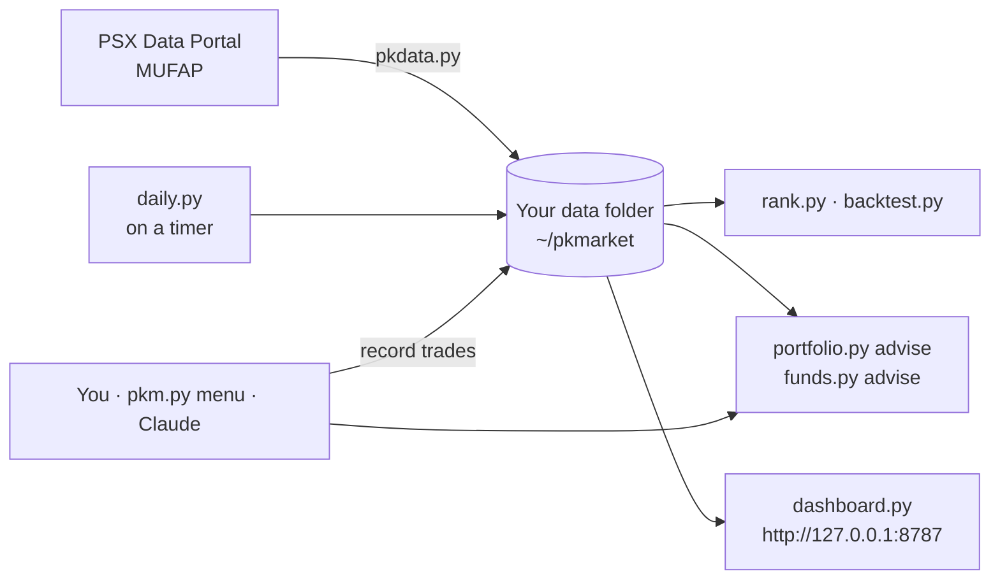

# Day-Trader-PSX

**Rank, compare, backtest and track Pakistan Stock Exchange shares and MUFAP mutual funds:
from a laptop, from your phone, or by simply asking Claude.**

   

Buy low, sell high. This project does the arithmetic, the record-keeping and the charts. The
courage, the judgement and the final tap on your broker's app stay with you.

> [!CAUTION]
> **Research and practice only, not investment advice.** Suggestions are rules applied to past
> prices. Backtests describe history, not the future. Nothing here can place a real order,
> and that is deliberate.

---

## Table of contents

1. [The 30-second tour](#the-30-second-tour)
2. [How it fits together](#how-it-fits-together)
3. [Pick your path](#pick-your-path)
4. [Quick start on a computer](#quick-start-on-a-computer)
5. [Command cheat sheet](#command-cheat-sheet)
   - [Fetch data](#1-fetch-data)
   - [Set the schedule](#2-set-the-schedule)
   - [Which stocks to hold, buy or sell](#3-which-stocks-to-hold-buy-or-sell)
   - [Which mutual funds to hold](#4-which-mutual-funds-to-hold)
   - [Set up your brokers](#5-set-up-your-brokers)
   - [Record a buy or sell](#6-record-a-buy-or-sell)
   - [See your portfolio](#7-see-your-portfolio)
   - [Practise with paper money](#8-practise-with-paper-money)
6. [How the suggestions work](#how-the-suggestions-work)
7. [Run it on a schedule](#run-it-on-a-schedule)
8. [Run it on your Android phone](#run-it-on-your-android-phone)
9. [Use it with Claude](#use-it-with-claude)
10. [Settings](#settings)
11. [Brokers and their charges](#brokers-and-their-charges)
12. [Your data and privacy](#your-data-and-privacy)
13. [Troubleshooting](#troubleshooting)
14. [FAQ](#faq)
15. [Data sources and terms](#data-sources-and-terms)
16. [Honest limits](#honest-limits)
17. [Repo layout](#repo-layout)
18. [Contributing](#contributing)

---

## The 30-second tour

| You want to… | It gives you… |
|---|---|
| Know what's doing well | Your watchlist or **every listed share**, ranked on 1-week to 1-year returns, risk, trend and lead or lag against the KSE-100, with sector, **Shariah status** (KMI All Share) and **dividend yield** |
| Pick a mutual fund | MUFAP funds ranked **inside their own category**, and suggestions by risk appetite: low, medium or high, Shariah or conventional |
| Track your real portfolio | Every trade with date, broker and actual charges; first-in-first-out lots per broker; mutual funds; realised and unrealised P/L after costs; dividends; what each broker has cost you |
| Know what to do next | **SELL / TRIM / REVIEW / HOLD** for each holding, with a trailing **stop-loss** and target. **Buy ideas**, each with entry, stop-loss, target and a sensible quantity |
| Test an idea first | Backtests of moving-average, breakout, RSI and momentum strategies, with costs, next-day fills and an honest out-of-sample test |
| Practise | A paper account in pretend PKR: all of the drama, none of the margin calls |
| See it all | A dashboard (overview, screener, compare up to 6 companies, your portfolio, dividends, funds) that works on a phone, in light and dark |

Plain Python 3.8+ with the standard library only: nothing to `pip install`, nothing to break.

## How it fits together



**One repo, two jobs.** The `psx-mufap/` folder is both:

- a **Claude skill**: `SKILL.md` teaches Claude to use the tools, so you can ask in plain English;
- a set of **command-line tools** in `psx-mufap/scripts/` that you run yourself.

Claude runs the very same scripts you do. One codebase, no "works on my machine" excuses.

**Your data never lives in the repo.** Everything downloaded or recorded goes to your own data
folder (see [Your data and privacy](#your-data-and-privacy)).

## Pick your path

| I have… | Go to | Time |
|---|---|---|
| A Linux, macOS or Windows (WSL) computer | [Quick start on a computer](#quick-start-on-a-computer) | 5 minutes |
| Just an Android phone | [Run it on your Android phone](#run-it-on-your-android-phone) | 20 minutes |
| The Claude app and a question | [Use it with Claude](#use-it-with-claude) | 1 minute |

## Quick start on a computer

```bash
git clone https://github.com/salmankhwaja/Day-Trader-PSX.git
cd Day-Trader-PSX/psx-mufap/scripts
python3 pkdata.py init             # creates ~/pkmarket/config.json: put your watchlist in it
python3 pkdata.py psx --watchlist  # your first prices
python3 rank.py stocks             # your first ranking
```

> [!TIP]
> Every command below runs from `psx-mufap/scripts`, and `--help` works on all of them.
> Not a fan of typing? `python3 pkm.py` opens a numbered menu and asks you questions instead.

---

## Command cheat sheet

### 1. Fetch data

```bash
# Your watchlist: a minute or two
python3 pkdata.py psx --watchlist         # daily prices for the watchlist + KSE-100
python3 pkdata.py company --watchlist     # sector, P/E, dividend history (cached for 7 days)
python3 pkdata.py universe                # every listed share + Shariah (KMI) flags
python3 pkdata.py payouts                 # latest dividend announcements and book closures
python3 pkdata.py mufap                   # today's MUFAP table: every fund's NAV and returns
```

```bash
# The whole market: 15–20 minutes the first time
python3 pkdata.py universe && python3 pkdata.py company --all && python3 pkdata.py psx --all
```

```bash
# Odds and ends
python3 pkdata.py psx LUCK DGKC MLCF              # just these symbols
python3 pkdata.py psx OGDC --from-file ogdc.json  # import a page you saved yourself
python3 pkdata.py status                          # what's on disk, and how fresh
```

> [!NOTE]
> The tools ask PSX for one page a second. We are guests on their server, not a stampede. That
> is why the first whole-market download takes a while; after that, company pages are cached
> for a week.

### 2. Set the schedule

```bash
./install_services.sh                                     # 07:00, Monday to Friday
PKM_SCHEDULE="07:00,04:00" ./install_services.sh          # twice a day
PKM_SCHEDULE="18:30" PKM_DAYS="Mon..Sat" ./install_services.sh
PKM_SCOPE=all PKM_SCHEDULE="04:00" ./install_services.sh  # whole market, overnight
```

```bash
systemctl --user list-timers pkm-daily.timer   # when is the next run?
systemctl --user start pkm-daily.service       # run it now
journalctl --user -u pkm-daily -n 100          # what did the last run say?
```

Full details are in [Run it on a schedule](#run-it-on-a-schedule). On a phone, see
[Run it on your Android phone](#run-it-on-your-android-phone).

### 3. Which stocks to hold, buy or sell

```bash
# Rankings
python3 rank.py stocks                          # your watchlist, best first
python3 rank.py stocks --all --top 20           # the whole market
python3 rank.py stocks --all --shariah --sector cement
python3 rank.py stocks --all --sort div_yield   # the dividend hunters' view
python3 rank.py sectors                         # sector league table
```

```bash
# Advice on your portfolio
python3 portfolio.py advise                         # SELL / TRIM / REVIEW / HOLD with stop-losses,
                                                    #   plus up to 3 buy ideas with entry, stop, target, quantity
python3 portfolio.py advise --all --shariah --buy 5 # buy ideas from the whole market, Shariah only
```

```bash
# Check an idea against history first
python3 backtest.py compare OGDC                        # how each strategy did on one share
python3 backtest.py run LUCK --strategy breakout --optimize
```

### 4. Which mutual funds to hold

```bash
python3 funds.py advise --risk low             # money market: steady and liquid
python3 funds.py advise --risk medium          # income, asset allocation, balanced, fund of funds
python3 funds.py advise --risk high --shariah  # equity and index funds, Shariah-compliant
python3 funds.py review                        # the funds you hold vs their category
python3 rank.py categories                     # every MUFAP category at a glance
python3 rank.py funds --category "Money Market" --top 10
```

> [!IMPORTANT]
> Funds are only compared **inside their own category**. Money market and income funds quote
> *annualised* returns, while equity and mixed funds quote *absolute* returns. Comparing the
> two is like comparing a cricket score with a hockey score: both numbers, different games.

### 5. Set up your brokers

```bash
python3 portfolio.py broker presets                          # published PSX broker tariffs, with sources
python3 portfolio.py broker add AKD --preset akd --default   # start from a preset
python3 portfolio.py broker import js-global,scs              # several at once
python3 portfolio.py broker add MyBroker --commission-pct 0.12 --per-share 0.03 \
        --min-commission 0 --sales-tax-pct 13                 # or your own commission sheet
python3 portfolio.py broker list
```

What the presets contain is explained in [Brokers and their charges](#brokers-and-their-charges).

### 6. Record a buy or sell

```bash
# Without a stop-loss: one is computed and trailed for you every day
python3 portfolio.py buy OGDC 500 298 --broker AKD --date 2026-10-25

# With your own stop-loss
python3 portfolio.py buy OGDC 500 298 --broker AKD --date 2026-10-25 --stop 280

# With the exact charges from your contract note (otherwise estimated, and marked as such)
python3 portfolio.py buy MCB 100 300 --broker AKD --commission 45 --taxes 5.85 --other 1.75
```

```bash
# Change your mind about the stop
python3 portfolio.py stop OGDC 285     # your stop
python3 portfolio.py stop OGDC auto    # back to the computed, trailing stop

# Sell some, or all
python3 portfolio.py sell OGDC 200 315 --broker AKD --date 2026-11-10 --commission 94.5
python3 portfolio.py sell OGDC all 320 --broker AKD
```

```bash
# Mutual funds
python3 portfolio.py fund-buy "Alfalah Cash Fund - II" 200000 --nav 106.73
python3 portfolio.py fund-sell "Alfalah Cash Fund - II" all --nav 108.10
```

<details>
<summary><b>Dividends, cash, bulk import and fixing mistakes</b></summary>

```bash
python3 portfolio.py dividends              # dividends due from book closures (check, then --apply)
python3 portfolio.py dividend OGDC 3825     # or record the exact net amount you received
python3 portfolio.py cash deposit 500000    # optional: buy ideas then fit your cash
python3 portfolio.py import my-trades.csv   # columns: date,side,symbol,qty,price,broker,commission,taxes,other,note,stop
python3 portfolio.py trades                 # the full ledger, with ids
python3 portfolio.py delete 7               # remove entry #7 (typos happen; markets don't care)
```

</details>

> [!NOTE]
> Shares live at a broker, so a sale uses *that broker's* oldest shares first. You also can't
> sell shares you didn't hold there on that date. Back-dating a sale to before the purchase is
> politely refused: time travel is out of scope.

### 7. See your portfolio

```bash
python3 portfolio.py holdings          # shares and funds: average cost incl. charges, value, P/L, stop
python3 portfolio.py pnl --year 2026   # realised profit per sale and redemption, after all charges
python3 portfolio.py fees              # what each broker has cost you (brace yourself)
python3 portfolio.py export trades.csv
python3 dashboard.py build && python3 dashboard.py serve    # http://127.0.0.1:8787 › My portfolio
```

### 8. Practise with paper money

```bash
python3 paper.py init --cash 1000000   # a pretend million rupees; spend it wisely, or not
python3 propose.py run --all           # screen, backtest, show the proposal (books nothing)
python3 propose.py run --all --apply   # buy the picks in the paper account
python3 propose.py review              # HOLD or SELL each paper holding
python3 paper.py status
```

---

## How the suggestions work

The past is a great teacher and a terrible fortune teller. Every rule below is plain, written
down, and adjustable in `config.json`.

**Stocks** (`portfolio.py advise`)

| Rule | Default |
|---|---|
| **Stop-loss** | 2.5 × the 14-day average daily move below your entry, kept 5–15% below it, then trailing up behind the highest close since you bought. Your own stop (`--stop`, or `portfolio.py stop`) always wins. Think of it as the seatbelt nobody likes wearing until they need it. |
| **Target** | entry + 2 × (entry − stop) |
| **SELL** | the last close is at or below the stop |
| **TRIM** | one stock is over 25% of the portfolio, and it says how many to sell |
| **REVIEW** | below its 50- and 200-day averages and more than 5 points behind the KSE-100 over 3 months |
| **HOLD** | none of the above; shows the distance to the stop and flags an upcoming book closure |
| **Buy ideas** | stocks whose best strategy was tuned on the first 70% of history, then did well on the untouched last 30% (beat a cash return, positive Sharpe ratio, drawdown under 35%), and that say "buy" today. Quantity risks 1% of your capital between entry and stop, at most 25% in one stock, within your recorded cash. |

**Why the 70/30 split?** Tuning a strategy on the same data you grade it on is like setting your
own exam paper. So the last 30% stays locked away until the very end, and only that result counts.

**Funds** (`funds.py`)

| Risk | MUFAP categories |
|---|---|
| low | Money Market |
| medium | Income, Aggressive Fixed Income, Asset Allocation, Balanced, Fund of Funds |
| high | Equity, Index Tracker, Dedicated Equity |

Within a category, funds rank on the average percentile of their 30-day, 90-day and 1-year
returns. One lucky week is not enough. Funds with a NAV more than 5 days old are left out. A
fund you hold is marked **REVIEW** when it sits in the bottom third of its category, and the
category leaders are named.

> [!WARNING]
> Suggestions use the **last close or NAV**, not live prices. Check the live price before you
> act, and remember the order button is on your broker's app, not here.

---

## Run it on a schedule

PSX publishes closing prices after the 15:30 close. A run at **04:00 or 07:00** works from the
previous session and is ready before the 09:30 open, with your chai.

```bash
cd psx-mufap/scripts
./install_services.sh                                     # 07:00, Monday to Friday
PKM_SCHEDULE="07:00,04:00" ./install_services.sh          # twice a day
PKM_SCHEDULE="18:30" PKM_DAYS="Mon..Sat" ./install_services.sh
PKM_SCOPE=all PKM_SCHEDULE="04:00" ./install_services.sh  # whole market, overnight
```

- **Times** are 24-hour Pakistan time (`PKM_TZ` to change), comma-separated.
- **Days** (`PKM_DAYS`) take `Mon..Fri`, `Mon,Wed,Fri`, `Mon..Sat` or `*`.
- Typos are caught before anything is installed. Run the script again to change the schedule.

It installs two systemd *user* services (no root needed):

| Service | What it does |
|---|---|
| `pkm-daily.timer` | At your times: refreshes prices, company data, payouts and MUFAP; credits paper dividends; lists dividends due on your real holdings (for you to confirm); writes your sell / hold / buy suggestions with stop-losses; reviews your funds; makes a fresh paper proposal on Fridays; rebuilds the dashboard |
| `pkm-dashboard.service` | The dashboard server: read-only, on `127.0.0.1:8787` |

<details>
<summary><b>No systemd? Use cron</b></summary>

With the computer's clock on Pakistan time, for 04:00 and 07:00 on weekdays:

```bash
0 4,7 * * 1-5  /path/to/Day-Trader-PSX/psx-mufap/scripts/daily_sync.sh >> ~/pkmarket-sync.log 2>&1
```

</details>

<details>
<summary><b>See the computer's dashboard from your phone</b></summary>

- **Simplest:** `python3 dashboard.py build --standalone pkm.html`, then send yourself the file
  and open it in the phone's browser.
- **Always up to date:** put the computer and phone on a private network such as Tailscale, and
  reinstall with a host and password:

  ```bash
  PKM_DASH_HOST=<computer's Tailscale IP> PKM_DASHBOARD_PASSWORD='<long password>' ./install_services.sh
  ```

  The server refuses any address other than localhost without a password. It serves only its
  three files, accepts GET only, and sends strict security headers. It speaks plain HTTP, so
  never expose it to the open internet.

</details>

---

## Run it on your Android phone

Everything above, on the phone in your pocket: data, rankings, advice, your portfolio and the
dashboard on your home screen. No computer needed. It takes about 20 minutes, most of it
waiting for downloads.

**You need:** Android 7 or newer, about 500 MB free, Wi-Fi for the first download, and Chrome.

The guide uses **Termux**, a free Linux terminal for Android, because it can run updates on a
timer and keep the dashboard alive. Just want to run things by hand? See the
[Pydroid 3 alternative](#the-pydroid-3-alternative).

### Step 1: install three apps from F-Droid

The Play Store's Termux is outdated, so use F-Droid:

1. In the phone's browser, open **f-droid.org**, then download and install the F-Droid app.
   Allow "install unknown apps" for your browser when Android asks.
2. In F-Droid, install **Termux**, **Termux:Widget** (home-screen buttons) and **Termux:Boot**
   (restarts things after a reboot).
3. Open **Termux:Boot** once, so Android lets it start at boot. Then open **Termux**.

### Step 2: install Python, the code and the services

In Termux (long-press to paste):

```bash
pkg update -y && pkg install -y python git
termux-setup-storage
```

Tap **Allow**. Your data will live in **Internal storage › pkmarket**, where your Files app and
backups can see it. Then:

```bash
git clone https://github.com/salmankhwaja/Day-Trader-PSX.git
bash Day-Trader-PSX/psx-mufap/scripts/android_setup.sh
```

That one script:
- installs the timer tools and creates your settings file;
- schedules the daily update for **07:00, Monday to Friday**;
- starts the dashboard in the background;
- adds home-screen buttons and makes everything restart after a reboot.

> [!TIP]
> If it asks you to restart Termux, type `exit`, open Termux again, and run the same `bash`
> line again. It's safe to repeat, and also how you change the times:
>
> ```bash
> PKM_SCHEDULE="07:00,04:00" bash Day-Trader-PSX/psx-mufap/scripts/android_setup.sh
> PKM_SCOPE=all PKM_SCHEDULE="04:00" bash Day-Trader-PSX/psx-mufap/scripts/android_setup.sh
> ```
>
> Times use the phone's clock and time zone.

### Step 3: let it run in the background

Android is very keen on saving battery, and will quietly put Termux to sleep at 06:59 unless
told otherwise:

- **Settings › Apps › Termux › Battery › Unrestricted**. The wording varies by phone maker; look
  for "battery optimisation" or "background usage".
- Leave Termux's notification in place. It's Termux saying "still awake".

### Step 4: your watchlist and broker

```bash
cd ~/Day-Trader-PSX/psx-mufap/scripts && python pkm.py
```

1. **13 Settings** › change the watchlist, e.g. `OGDC,PPL,MARI,HUBC,LUCK,MCB,MEBL,ENGRO,FFC,SYS`.
2. **10 Brokers** › answer **y** to add yours: e.g. name `AKD`, preset `akd`, make it the default.
   If your rate differs, leave the preset blank and type in your commission sheet.

### Step 5: the first download

- **1 Fetch data: my watchlist + funds**: about 2 minutes.
- **2 Fetch data: the whole market** (optional): 15–20 minutes and about 200 MB, so use Wi-Fi
  with the screen on. You need it for whole-market rankings, sectors and buy ideas from every
  share.

### Step 6: put in what you already own

- **6 Record a BUY** for each holding. It asks for the symbol, quantity, price, broker and date;
  the charges from your contract note (blank = estimated); and your own stop-loss (blank =
  computed and trailed daily).
- **8 Record a mutual fund buy / sell** for each fund.
- Lots of trades? Put a CSV in **Internal storage › pkmarket** and import it:

  ```bash
  python portfolio.py import /storage/emulated/0/pkmarket/my-trades.csv
  ```

### Step 7: open your dashboard

In Chrome, go to **http://127.0.0.1:8787**, then Chrome menu › **Add to Home screen**.
Congratulations: you now have a trading terminal that cost less than a samosa.

| Tab | Shows |
|---|---|
| Overview | KSE-100, sectors, top-ranked shares, dividends coming up |
| Screener | every ranked share; filter by sector, Shariah, yield; tick to compare |
| Compare | up to 6 companies side by side, dividends included |
| My portfolio | what to sell, trim or hold, each with stop-loss and target; buy ideas with quantity; your funds; costs by broker; realised P/L |
| Paper · Dividends · Funds | practice account, dividend calendar, MUFAP rankings |

The address only works on this phone: nothing leaves the device. If the page won't load, open
Termux once, which wakes the dashboard service.

### Step 8: everyday use

| When | Do |
|---|---|
| Every weekday at 07:00 | Nothing. Prices, dividends, advice and the dashboard refresh themselves |
| You bought or sold something | Home-screen **PSX-menu** › **6** or **7** |
| You want advice now | **PSX-menu** › **4** for stocks with stop-losses, **5** for funds |
| You want fresh data now | Home-screen **PSX-update** |
| You want the dashboard | Home-screen **PSX-dashboard**, or the Chrome icon |

To add the buttons: long-press the home screen › Widgets › **Termux:Widget**.

### Step 9: keep it safe and current

```bash
cd ~/Day-Trader-PSX && git pull   # the latest code; your data isn't touched
```

> [!IMPORTANT]
> Back up **Internal storage › pkmarket › portfolio/ledger.json** now and then, to Google Drive
> or a computer. Prices can be downloaded again; your trade history can't.

The last update's log is in **Internal storage › pkmarket › daily.log**.

### The Pydroid 3 alternative

No timer, no background dashboard, but very easy:

1. Install **Pydroid 3** from the Play Store.
2. On this GitHub page, tap **Code › Download ZIP**, then extract it into **Internal storage › Download**.
3. In Pydroid, tap the folder icon › open `Download/Day-Trader-PSX-main/psx-mufap/scripts/pkm.py`
   › **▶ Run**, and allow storage access.
4. Follow Steps 4 to 6 above in the menu. Choose **11** whenever you want fresh data.
5. For the dashboard, choose **12**, then in the Files app open **pkmarket › dashboard.html**
   with Chrome.

---

## Use it with Claude

**Claude app (phone, web, desktop):** download `psx-mufap.zip` from the
[releases page](https://github.com/salmankhwaja/Day-Trader-PSX/releases), or make it yourself:

```bash
zip -r psx-mufap.zip psx-mufap
```

Then add it as a custom skill in Claude's settings, and just ask:

- *"Top 5 Shariah-compliant stocks by 3-month return"*
- *"Compare LUCK, DGKC and MLCF, including dividends"*
- *"I bought 500 OGDC at 298 through AKD today, commission 223.50, stop-loss at 280"*
- *"What should I sell, and what could I buy, with stop-losses?"*
- *"Which Shariah money market funds should I consider, and how do mine compare?"*
- *"How much have I paid each broker this year, and what's my realised profit?"*
- *"Add my broker: 0.12% or 3 paisa a share, whichever is higher, Sindh sales tax"*

Claude reads a trade back to you before recording it, and asks for anything important you left
out.

> [!NOTE]
> Claude's phone sandbox blocks most websites. It fetches pages with its own web tools instead,
> which works for MUFAP; PSX pages may stay out of reach. For full PSX data in the Claude app, run
> the daily update on a computer and keep the data folder in **your own private** git repo: set
> `PKM_HOME` to it and `PKM_GIT_PUSH=1`. Claude can then read your data from there.

**Claude Code:**

```bash
cp -r Day-Trader-PSX/psx-mufap ~/.claude/skills/
```

Or install it as a plugin: `/plugin marketplace add salmankhwaja/Day-Trader-PSX`, then
`/plugin install psx-mufap@pk-market-skill`.

---

## Settings

`config.json` in your data folder. `pkdata.py init` creates it, and anything missing uses the
default.

```json
{
  "watchlist": ["OGDC", "PPL", "MARI", "HUBC", "LUCK", "MCB", "MEBL", "ENGRO", "FFC", "SYS"],
  "benchmark": "KSE100",
  "cost_bps_per_side": 20,
  "lot_size": 1,
  "risk_free_annual": 0.0,
  "paper_starting_cash": 1000000,
  "min_avg_volume": 50000,
  "dividend_tax": 0.15,
  "face_values": {},
  "stop_atr_mult": 2.5,
  "min_stop_pct": 0.05,
  "max_stop_pct": 0.15,
  "target_r": 2.0,
  "risk_per_trade": 0.01,
  "max_position_pct": 0.25
}
```

| Setting | Meaning |
|---|---|
| `watchlist`, `benchmark` | the shares you follow, and what they're measured against |
| `cost_bps_per_side` | trading cost in **backtests**, in basis points per buy or sell (20 = 0.2%) |
| `risk_free_annual` | what idle cash earns, e.g. `0.11` for an 11% money-market yield; strategies must beat it |
| `min_avg_volume` | with `--all`, skip shares trading fewer than this many a day (60-day average) |
| `dividend_tax` | withholding tax on dividends (rates differ for filers and non-filers) |
| `face_values` | dividend per share = percent × face value; Rs 10 unless listed, e.g. `{"ABC": 5}` |
| `stop_atr_mult`, `min_stop_pct`, `max_stop_pct` | how far below entry the stop-loss sits |
| `target_r` | target = entry + this × (entry − stop) |
| `risk_per_trade` | share of capital lost if a buy idea hits its stop (0.01 = 1%) |
| `max_position_pct` | most of the portfolio in one stock before TRIM (0.25 = 25%) |

Real brokers' charges don't live here; they live with each broker in your ledger. See
[Brokers and their charges](#brokers-and-their-charges).

## Brokers and their charges

Commissions are negotiable. The tax man, less so. The presets in
[`psx-mufap/brokers.json`](psx-mufap/brokers.json) give each broker's published commission, plus
the pass-through charges:

| Charge | Default | Source |
|---|---|---|
| Commission floor (PSX regulation) | Rs 0.03 per share or 0.15% of value, whichever is higher; at most 2.5% | PSX Regulations, Ch. 4, Annexure-III |
| Broker presets | AKD, MRA, JS Global, Khanani, KTrade, Topline, SCS, Optimus, Arif Habib, Next Capital, Sherman, with price slabs where published | links and confidence notes in the file |
| Sales tax on commission | 13% (Sindh) | AKD fee page |
| CDC handling | Rs 0.005 per share | AKD fee page |
| Exchange and regulator levies | about Rs 4.15 per Rs 100,000 | press, Aug 2026 |
| Capital value tax on buys | 0 (set `cvt_pct` if your contract note shows it) | press, Aug 2026 |

> [!TIP]
> Your signed commission sheet beats any preset. Add your broker by hand
> (`--commission-pct`, `--per-share`, `--sales-tax-pct`) or edit the file. Charges you type in
> from a contract note always override the estimate.

## Your data and privacy

The code repo holds **no market data and no portfolio**. Everything goes to your data folder:
`~/pkmarket` on a computer, **Internal storage › pkmarket** on Android. Change it with
`PKM_HOME=/path` or `--home /path`.

```text
pkmarket/
├── config.json            your settings
├── universe.json          every listed share + Shariah flags
├── psx/<SYMBOL>.csv       daily prices
├── companies/             sector, P/E, dividend history per company
├── payouts.json           latest dividend announcements
├── mufap/                 daily fund snapshots + NAV history
├── portfolio/ledger.json  your real trades, funds, brokers and charges  ← back this up
├── advice/                daily sell / hold / buy suggestions
├── paper/portfolio.json   your paper account
├── proposals/             paper portfolio proposals
├── dashboard/             the dashboard (served at 127.0.0.1:8787)
├── dashboard.html         the one-file dashboard
└── daily.log              what the last update did
```

> [!CAUTION]
> Never commit this folder to a public repo. PSX doesn't allow its market data to be
> republished, and your ledger is between you, your broker and the FBR. (`.gitignore` already
> excludes `pkmarket/`.)

---

## Troubleshooting

| Symptom | Likely cause | Fix |
|---|---|---|
| A download says `FAILED` | PSX or MUFAP busy, down, or blocked on this network | Try later. One failed share doesn't stop the rest. Or save the page and use `--from-file` |
| "no price data" in a ranking | Prices not fetched yet | `pkdata.py psx --watchlist` (or `--all`) |
| A buy idea has no quantity | No capital known | Record holdings, or `portfolio.py cash deposit AMOUNT` |
| "that would sell … shares not held" | Wrong broker or date on a sale | Check `portfolio.py trades`; shares sell from the broker that holds them |
| Charges marked "estimated" | No contract-note figures given | Pass `--commission`, `--taxes`, `--other`, or `delete` and re-record |
| The scheduled run didn't happen | Computer asleep, or (phone) battery saver | Linux: `systemctl --user list-timers`. Android: Termux battery Unrestricted, `sv-enable crond`, `crontab -l` |
| Dashboard won't load | Server not running | `python3 dashboard.py serve`; on Android open Termux once or `sv-enable pkm-dashboard`; or use `dashboard.html` |
| Charts are blank | No internet for the chart library | The charts load Chart.js from cdnjs; get online |
| Termux: "Permission denied" on storage | Storage not granted | `termux-setup-storage`, Allow, rerun `android_setup.sh` |

## FAQ

**Will it make me rich?** It will make you *informed*, which is cheaper and more reliable.

**Can it place orders for me?** No, by design. Your thumb stays in charge.

**Where do the prices come from?** The PSX Data Portal and MUFAP, at end of day. It isn't a
live ticker; see [Data sources and terms](#data-sources-and-terms).

**Why does "expected next dividend" say *estimate*?** It assumes the company pays at about the
same time as last year. That's a habit, not a promise, a bit like predicting when your cousin
will next ask for a loan.

**Is a passing backtest a guarantee?** No. It means the rule wasn't fooled by the data it was
tuned on. Markets remain free to do something new.

**Does it work offline?** Analysis, your ledger and the dashboard file do. Fresh prices and the
dashboard's charts need the internet.

**Why is my high-dividend stock ranked lower than I expected?** PSX prices don't include
dividends, so heavy payers look weaker on price returns. The dividend yield column evens the
score.

## Data sources and terms

- **PSX Data Portal** (`dps.psx.com.pk`): daily prices, index members (All Share, KMI All
  Share), company pages and payouts. PSX prohibits redistribution or commercial use of its market
  data without a licence (marketdatarequest@psx.com.pk). These tools are for personal analysis:
  keep downloaded data private and don't publish dashboards built from it.
- **MUFAP** (`mufap.com.pk`): daily fund NAVs and returns.
- The PSX endpoints are undocumented and can change; the parsers fail loudly when they do.
  Details are in [`psx-mufap/references/data-sources.md`](psx-mufap/references/data-sources.md).

## Honest limits

- Prices exclude dividends, so buy-and-hold returns of high payers are understated.
- No intraday highs and lows in the free PSX series, so stops are end-of-day.
- Bonus issues and splits show up as price drops; `pkdata.py` warns about one-day falls of 30%
  or more.
- Capital gains tax isn't calculated (it depends on filer status and holding period); record it
  with `--taxes` on a sale if you want it in your P/L.
- Broker presets come from published tariffs and summaries that can go out of date; your
  contract note is the truth.

## Repo layout

```text
psx-mufap/                      the skill and the tools
├── SKILL.md                    instructions Claude follows
├── brokers.json                published PSX broker tariffs and charges, with sources
├── scripts/
│   ├── pkm.py                  menu launcher for everything (phones, or menu lovers)
│   ├── pkdata.py               download / import prices, universe, company pages, payouts, MUFAP
│   ├── psxinfo.py              parsers for PSX pages; dividend maths
│   ├── rank.py                 rank stocks, sectors, funds
│   ├── backtest.py             strategies, metrics, out-of-sample checks
│   ├── propose.py              paper portfolio proposals and review
│   ├── paper.py                paper account
│   ├── portfolio.py            your real portfolio: trades, brokers, charges, lots, funds, P/L
│   ├── advice.py               stop-losses, sell/hold/trim rules, sized buy ideas
│   ├── funds.py                fund suggestions by risk profile; review of funds you hold
│   ├── dashboard.py            build and serve the dashboard
│   ├── daily.py                the daily pipeline, pure Python (Linux, macOS, Windows, Android)
│   ├── daily_sync.sh           shell wrapper for cron and systemd
│   ├── install_services.sh     systemd timer (your schedule) and dashboard service
│   └── android_setup.sh        one-command setup in Termux
├── dashboard/                  index.html + app.js (Chart.js 4.4.1 from cdnjs, pinned with SRI)
└── references/                 strategy and data-source notes
tests/                          offline tests on synthetic data and trimmed page samples
ci/                             GitHub Actions workflows, ready to enable (see ci/README.md)
```

Run the tests with no network needed:

```bash
python3 -m unittest discover tests
```

## Contributing

Issues and pull requests are welcome. House rules:

- standard-library Python only;
- a test for every parser change, with a trimmed page sample in `tests/fixtures/`;
- never commit real PSX price data, or anybody's ledger.

MIT licence. Built in Pakistan, tested on synthetic stocks that never once complained.
