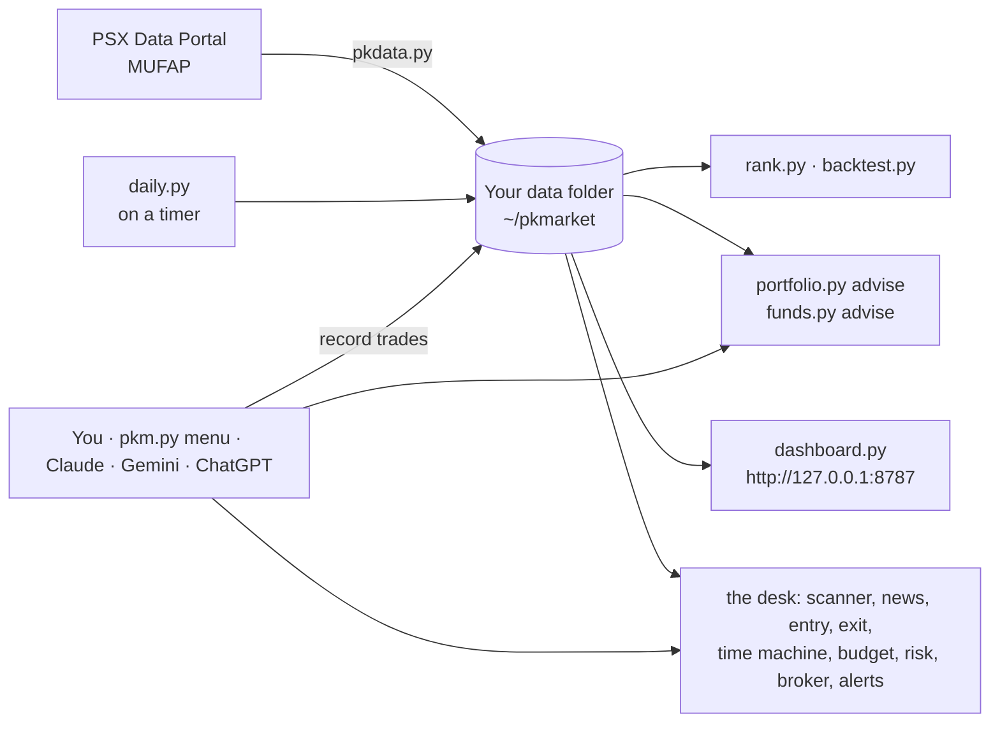
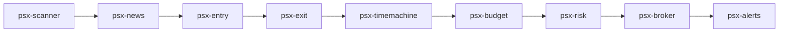

# Day-Trader-PSX: the full manual

Every command, setting and detail behind the skills. New here? Start with the
[README](../README.md): what to ask, setting up Claude, Gemini and ChatGPT, and your phone.

> [!CAUTION]
> **Research and practice only, not investment advice.** Suggestions are rules applied to past
> prices. Backtests describe history, not the future. Nothing here can place a real order,
> and that is deliberate. Most people who day trade lose money.

---

## Table of contents

1. [Your data: where it lives, backups and moving between chats](#your-data-where-it-lives-backups-and-moving-between-chats)
2. [Where the data comes from](#where-the-data-comes-from)
3. [How it fits together](#how-it-fits-together)
4. [Command cheat sheet](#command-cheat-sheet)
   - [Your watchlist](#1-your-watchlist)
   - [Fetch data](#2-fetch-data)
   - [Set the schedule](#3-set-the-schedule)
   - [Which stocks to hold, buy or sell](#4-which-stocks-to-hold-buy-or-sell)
   - [Which mutual funds to hold](#5-which-mutual-funds-to-hold)
   - [Set up your brokers](#6-set-up-your-brokers)
   - [Record a buy or sell](#7-record-a-buy-or-sell)
   - [See your portfolio](#8-see-your-portfolio)
   - [Practise with paper money](#9-practise-with-paper-money)
   - [Know your risk](#10-know-your-risk)
   - [Plan a SIP](#11-plan-a-sip)
   - [Last fetch, fresh fetch or live?](#12-last-fetch-fresh-fetch-or-live)
   - [A second opinion: PakistaniBulls](#13-a-second-opinion-pakistanibulls)
5. [The day-trading desk: 11 PSX skills](#the-day-trading-desk-11-psx-skills)
6. [Your risk style](#your-risk-style)
7. [How the suggestions work](#how-the-suggestions-work)
8. [Run it on a schedule](#run-it-on-a-schedule)
9. [Run it on your Android phone](#run-it-on-your-android-phone)
10. [Settings](#settings)
11. [Brokers and their charges](#brokers-and-their-charges)
12. [Troubleshooting](#troubleshooting)
13. [FAQ](#faq)
14. [Data terms](#data-terms)
15. [Honest limits](#honest-limits)
16. [Repo layout](#repo-layout)
17. [Contributing](#contributing)

---

## Your data: where it lives, backups and moving between chats

The code repo holds **no market data and no portfolio**. Everything goes to your data folder:
`~/pkmarket` on a computer, **Internal storage › pkmarket** on Android, a fresh folder in each
chat sandbox. Change it with `PKM_HOME=/path` or `--home /path`.

```text
pkmarket/
├── config.json            your settings, watchlist and risk style
├── portfolio/ledger.json  your real trades, funds, brokers, charges and stops   ← precious
├── psx/<SYMBOL>.csv       daily prices
├── live.json              the last live prices
├── companies/             each company's page: announcements, results, payouts
├── universe.json          every listed share + Shariah flags
├── payouts.json           latest dividend announcements
├── mufap/                 daily fund snapshots + NAV history
├── advice/                daily sell / hold / buy suggestions and order tickets
├── trader/                the desk: setups, plan, orders, risk verdicts, tickets, alerts
├── intraday/              today's trades per share, kept day by day (for the time machine)
├── signals/               a second opinion you imported (PakistaniBulls)
├── paper/                 your paper account
├── dashboard/, dashboard.html   the dashboard
└── daily.log              what the last update did
```

**One zip carries all of it**, between devices and between chats:

```bash
python3 pkdata.py backup                     # pkmarket-backup-2026-10-27.zip: records + prices
python3 pkdata.py backup --small             # just your records (ledger, settings, desk files): tiny
python3 pkdata.py restore pkmarket-backup-2026-10-27.zip   # on another device, or in a new chat
```

- **Chat apps** (Claude, Gemini, ChatGPT): attach the latest zip when you start a chat; the
  assistant restores it, and after you record anything it gives you the new zip. Keep the newest.
- **Computer and phone together:** make the backup on the machine that runs the daily update, and
  attach that in the chat apps, so they work with today's prices.
- **Restore is careful:** it only writes inside the data folder (paths that try to escape it are
  skipped), and keeps your current `config.json` and ledger as `*.before-restore` unless you say
  `--replace`.

> [!CAUTION]
> The backup and the data folder are private: your trades, your brokers, PSX's data. Never commit
> them to a public repo or share them (PSX doesn't allow its market data to be republished, and your
> ledger is between you, your broker and the FBR). `.gitignore` already excludes `pkmarket/`.


## Where the data comes from

Straight from the source, no middlemen, no paid feed:

| What | Where it's downloaded from | Used for |
|---|---|---|
| Daily prices (about 5 years of close, volume, open) | PSX Data Portal, `dps.psx.com.pk/timeseries/eod/<SYMBOL>` | rankings, backtests, stop-losses, risk, the dashboard |
| Live prices (every share's current price, high, low, volume) | PSX Data Portal, `/market-watch` | `--live` advice, `pkdata.py live`, the dashboard's Live prices |
| Every listed share | PSX Data Portal, `/indices/ALLSHR` (KSE All Share Index) | whole-market mode (`--all`) |
| Shariah-compliant shares | PSX Data Portal, `/indices/KMIALLSHR` (KMI All Share Islamic Index) | the ☪ flag and Shariah filters |
| Sector, P/E, 52-week range, dividend history | PSX Data Portal, `/company/<SYMBOL>` | sectors, valuation, dividend yield |
| New dividends and book closures | PSX Data Portal, `/payouts` | dividend calendar, dividends due |
| Mutual funds: every fund's NAV and returns | MUFAP, `mufap.com.pk` daily performance summary | fund rankings, fund advice, SIP rates |
| Broker tariffs | Published rate sheets, listed in [`brokers.json`](../psx-mufap/brokers.json) | estimating charges |
| Company announcements, results, insiders' dealings | PSX Data Portal, `/company/<SYMBOL>` (Announcements, Financials, Ratios) | psx-news, psx-analyst, psx-insiders |
| Today's trades, minute by minute | PSX Data Portal, `/timeseries/int/<SYMBOL>` | opening-range breakouts, psx-entry, the time machine |
| A second opinion (optional) | PakistaniBulls' PSX signal list: a page you save, or their public list after you accept their terms | the "PakistaniBulls says" column beside the advice |

`pkdata.py` downloads these politely: one page a second. The PSX price page is undocumented,
so every download is checked before it's saved.

> [!NOTE]
> **"The price URL gives me 404!"** It does, in a browser. Since late 2026 the PSX portal only
> answers its data URLs (`/timeseries/...`, `/indices/...`, `/payouts`) for requests that come with
> its own page's session: a cookie plus a key that every portal page carries (`window.__ps._k`),
> sent back as an `X-Req-Id` header. The tools do exactly what the portal's own chart does: open
> a normal page, read the key, then ask for the data. Company pages (`/company/<SYMBOL>`) still
> open normally.

Format details are in [`references/data-sources.md`](../psx-mufap/references/data-sources.md);
terms of use are under [Data terms](#data-terms).

## How it fits together



**One codebase, twelve skills.** The tools live in `psx-mufap/scripts/`. `psx-mufap/` is the main
skill (its `SKILL.md` teaches the assistant to use them); the 11 desk skills (`psx-scanner/` …
`psx-insiders/`) each carry a synced copy of the tools they need, so each installs on its own.
The assistant runs the very same scripts you do: no "works on my machine" excuses.

**Your data never lives in the repo.** Everything downloaded or recorded goes to your own data
folder (see [Your data and privacy](#your-data-where-it-lives-backups-and-moving-between-chats)).

---

## Command cheat sheet

> [!TIP]
> Every command runs from `psx-mufap/scripts` (or a desk skill's `scripts/` folder), and `--help`
> works on all of them. Not a fan of typing? `python3 pkm.py` opens a numbered menu.

### 1. Your watchlist

Your watchlist is the list of shares you follow. Rankings, buy ideas, the daily download and the
dashboard start from it (unless you ask for the whole market with `--all`). Shares you *hold* are
always tracked, watchlisted or not.

```bash
python3 watchlist.py                                  # the list: name, sector, ☪, last price, 1-month move, held?
python3 watchlist.py add LUCK DGKC MLCF --fetch       # add shares and download their prices right away
python3 watchlist.py remove TRG                       # take one off (its price file stays, harmlessly)
python3 watchlist.py set OGDC PPL MARI HUBC MEBL      # replace the whole list
python3 watchlist.py add --top 5 --sector cement      # the 5 best-ranked cement shares
python3 watchlist.py add --top 10 --shariah           # the 10 best-ranked Shariah-compliant shares
python3 watchlist.py add --holdings                   # everything you own
python3 watchlist.py reset                            # back to the starter list of 20 big names
python3 watchlist.py export my-list.txt               # one symbol per line...
python3 watchlist.py import my-list.txt --replace     # ...and back again (or without --replace to add)
```

> [!TIP]
> Symbols are checked against the list of shares actually listed on PSX once you've run
> `pkdata.py universe` (it catches `OGCD` before it costs you a morning). `--top` ranks by score
> when prices are on file, otherwise by market cap. Prefer menus? `pkm.py` › **13 Watchlist and
> settings**. Prefer a text editor? It's the `watchlist` line in `config.json`.

### 2. Fetch data

```bash
# Your watchlist: a minute or two
python3 pkdata.py psx --watchlist         # daily prices for the watchlist + KSE-100
python3 pkdata.py company --watchlist     # sector, P/E, dividend history (cached for 7 days)
python3 pkdata.py universe                # every listed share + Shariah (KMI) flags
python3 pkdata.py payouts                 # latest dividend announcements and book closures
python3 pkdata.py mufap                   # today's MUFAP table: every fund's NAV and returns
```

```bash
# The whole market: 15–20 minutes the first time
python3 pkdata.py universe && python3 pkdata.py company --all && python3 pkdata.py psx --all
```

```bash
# Odds and ends
python3 pkdata.py psx LUCK DGKC MLCF              # just these symbols
python3 pkdata.py psx OGDC --from-file ogdc.json  # import a page you saved yourself
python3 pkdata.py status                          # what's on disk, and how fresh
python3 pkdata.py live                            # live prices: your watchlist and holdings, one request
                                                  # (the daily update runs it too: every share's last trade
                                                  #  feeds the dashboard's All shares by sector view)
```

> [!NOTE]
> The tools ask PSX for one page a second. We are guests on their server, not a stampede. That
> is why the first whole-market download takes a while; after that, company pages are cached
> for a week.

### 3. Set the schedule

```bash
./install_services.sh                                     # 07:00, Monday to Friday
PKM_SCHEDULE="07:00,04:00" ./install_services.sh          # twice a day
PKM_SCHEDULE="18:30" PKM_DAYS="Mon..Sat" ./install_services.sh
PKM_SCOPE=all PKM_SCHEDULE="04:00" ./install_services.sh  # whole market, overnight
```

```bash
systemctl --user list-timers pkm-daily.timer   # when is the next run?
systemctl --user start pkm-daily.service       # run it now
journalctl --user -u pkm-daily -n 100          # what did the last run say?
```

Full details are in [Run it on a schedule](#run-it-on-a-schedule). On a phone, see
[Run it on your Android phone](#run-it-on-your-android-phone).

### 4. Which stocks to hold, buy or sell

```bash
# Rankings
python3 rank.py stocks                          # your watchlist, best first
python3 rank.py stocks --all --top 20           # the whole market
python3 rank.py stocks --all --shariah --sector cement
python3 rank.py stocks --all --sort div_yield   # the dividend hunters' view
python3 rank.py sectors                         # sector league table
```

```bash
# Advice on your portfolio (each one asks first: fetch fresh data, or use what's on file?)
python3 portfolio.py advise                         # SELL / TRIM / REVIEW / HOLD with stop-losses,
                                                    #   plus up to 3 buy ideas with entry, stop, target, quantity,
                                                    #   and the price calculator for each
python3 portfolio.py advise --all --shariah --buy 5 # buy ideas from the whole market, Shariah only
python3 portfolio.py advise --fetch                 # download fresh prices first, no question asked
```

```bash
# One share, everything about it
python3 portfolio.py check OGDC                     # verdict for your style, backtest, stop, target, size,
                                                    #   and the price calculator
python3 portfolio.py check OGDC --entry 250 --stop 232 --capital 500000   # your own numbers
```

```bash
# Turn the advice into orders for your broker's app (nothing is sent: you type them in)
python3 portfolio.py orders --live        # stop-loss (trigger + limit) per holding, buys at the entry,
                                          #   sells and trims, optional take-profits, and how long each lasts
```

The **price calculator** comes with every holding and every buy idea, so a suggestion is never
just a word:

```text
SYN05 (BUY idea), buying: 2089 shares at 91.35 = PKR 190,830 + PKR 342 charges
  falls to the stop 86.78 (-5.0%): lose about PKR 10,214 after charges
  rises to the target 100.49 (+10.0%): gain about PKR 18,377 after charges
  reward-to-risk 1.8 to 1; worth it if it works more than 36% of the time; break-even after charges 91.68
```

For shares you already hold it also says what selling today, or at the stop, would make or lose
against what you paid. Charges come from your broker's schedule (see
[Brokers and their charges](#brokers-and-their-charges)).

```bash
# Check an idea against history first
python3 backtest.py compare OGDC                        # how each strategy did on one share
python3 backtest.py run LUCK --strategy breakout --optimize
```

### 5. Which mutual funds to hold

```bash
python3 funds.py advise --risk low             # money market: steady and liquid
python3 funds.py advise --risk medium          # income, asset allocation, balanced, fund of funds
python3 funds.py advise --risk high --shariah  # equity and index funds, Shariah-compliant
python3 funds.py review                        # the funds you hold vs their category
python3 rank.py categories                     # every MUFAP category at a glance
python3 rank.py funds --category "Money Market" --top 10
```

> [!IMPORTANT]
> Funds are only compared **inside their own category**. Money market and income funds quote
> *annualised* returns, while equity and mixed funds quote *absolute* returns. Comparing the
> two is like comparing a cricket score with a hockey score: both numbers, different games.

### 6. Set up your brokers

```bash
python3 portfolio.py broker presets                          # published PSX broker tariffs, with sources
python3 portfolio.py broker add AKD --preset akd --default   # start from a preset
python3 portfolio.py broker add Finqalab --preset finqalab    # 0.25% or 3 paisa/share; day-only stop-losses
python3 portfolio.py broker import js-global,scs              # several at once
python3 portfolio.py broker add MyBroker --commission-pct 0.12 --per-share 0.03 \
        --min-commission 0 --sales-tax-pct 13                 # or your own commission sheet
python3 portfolio.py broker list
```

What the presets contain is explained in [Brokers and their charges](#brokers-and-their-charges).

### 7. Record a buy or sell

```bash
# Without a stop-loss: one is computed and trailed for you every day
python3 portfolio.py buy OGDC 500 298 --broker AKD --date 2026-10-25

# With the time you bought (24-hour, Pakistan time; recorded today without one, it's stamped "now")
python3 portfolio.py buy OGDC 500 298 --broker AKD --date 2026-10-25 --time 10:42

# With your own stop-loss
python3 portfolio.py buy OGDC 500 298 --broker AKD --date 2026-10-25 --stop 280

# With the exact charges from your contract note (otherwise estimated, and marked as such)
python3 portfolio.py buy MCB 100 300 --broker AKD --commission 45 --taxes 5.85 --other 1.75
```

```bash
# Change your mind about the stop
python3 portfolio.py stop OGDC 285     # your stop
python3 portfolio.py stop OGDC auto    # back to the computed, trailing stop

# Sell some, or all
python3 portfolio.py sell OGDC 200 315 --broker AKD --date 2026-11-10 --commission 94.5
python3 portfolio.py sell OGDC all 320 --broker AKD
```

```bash
# Mutual funds
python3 portfolio.py fund-buy "Alfalah Cash Fund - II" 200000 --nav 106.73
python3 portfolio.py fund-sell "Alfalah Cash Fund - II" all --nav 108.10
```

<details>
<summary><b>Dividends, cash, bulk import and fixing mistakes</b></summary>

```bash
python3 portfolio.py dividends              # dividends due from book closures (check, then --apply)
python3 portfolio.py dividend OGDC 3825     # or record the exact net amount you received
python3 portfolio.py cash deposit 500000    # optional: buy ideas then fit your cash
python3 portfolio.py import my-trades.csv   # columns: date,side,symbol,qty,price,broker,commission,taxes,other,note,stop,time
python3 portfolio.py trades                 # the full ledger, with ids
python3 portfolio.py delete 7               # remove entry #7 (typos happen; markets don't care)
```

</details>

> [!NOTE]
> Shares live at a broker, so a sale uses *that broker's* oldest shares first. You also can't
> sell shares you didn't hold there on that date. Back-dating a sale to before the purchase is
> politely refused: time travel is out of scope.

### 8. See your portfolio

```bash
python3 portfolio.py holdings          # each share: bought (price, date, time) vs now (live or close): GREEN or RED
python3 portfolio.py holdings --lots   # ...and every purchase on its own
python3 portfolio.py holdings --live   # judged at live prices
python3 portfolio.py pnl --year 2026   # realised profit per sale and redemption, after all charges
python3 portfolio.py fees              # what each broker has cost you (brace yourself)
python3 portfolio.py export trades.csv
python3 dashboard.py build && python3 dashboard.py serve    # http://127.0.0.1:8787 › My portfolio
```

**GREEN or RED?** Each holding compares what you paid, and when, with what it's worth now, and
when that price is from:

```text
| Stock | Status  | Bought (avg cost incl. charges, first buy) | Now                              | Qty | P/L if sold now       |
|-------|---------|--------------------------------------------|----------------------------------|-----|-----------------------|
| OGDC  | ▲ GREEN | 298.62 on 2026-10-25 10:42                 | 311.40 live at 2026-10-27 11:42  | 500 | +PKR 6,021 (+4.0%)    |
| MCB   | ▼ RED   | 301.20 on 2026-09-14 13:05 (2 buys)        | 289.75 close of 2026-10-26 15:30 | 200 | -PKR 2,465 (-4.1%)    |
```

- **GREEN** means selling at the price now would make money after the charges on *both* sides:
  what you paid (price plus buying charges) against what you'd receive (price minus estimated
  selling charges). **RED** means it would lose. A share that's up a hair can still be red once
  the broker has had their cut.
- **Now** is the live price with its time when you use `--live` (or switch on Live prices in the
  dashboard); otherwise it's the last close, stamped 15:30, Pakistan time.
- Bought the same share more than once? `--lots` (and the dashboard) shows each purchase with its
  own date, time, broker and colour. Your second buy can be red while the first is green.
- On a terminal the words are coloured; set `NO_COLOR=1` if you'd rather not.

### 9. Practise with paper money

```bash
python3 paper.py init --cash 1000000   # a pretend million rupees; spend it wisely, or not
python3 propose.py run --all           # screen, backtest, show the proposal (books nothing)
python3 propose.py run --all --apply   # buy the picks in the paper account
python3 propose.py review              # HOLD or SELL each paper holding
python3 paper.py status
```

### 10. Know your risk

```bash
python3 risk.py quiz                     # 8 questions -> conservative / moderate / aggressive / very aggressive
python3 risk.py profile                  # the four styles side by side
python3 risk.py profile aggressive       # switch style directly
python3 risk.py settings                 # every buy/sell variable, its value, and where it came from
python3 risk.py set max_holdings 6       # override one value (your values beat the profile)
python3 risk.py unset max_holdings       # back to the profile's value
```

```bash
python3 risk.py position --entry 300 --stop 282                    # how many shares, and what's at stake
python3 risk.py position --entry 300 --stop 282 --capital 1000000 --risk-pct 1
python3 risk.py portfolio                # money at risk to your stops, value-at-risk, volatility, beta,
                                         #   diversification, allocation vs target, and warnings
```

### 11. Plan a SIP

```bash
python3 sip.py plan --monthly 25000 --years 10                  # at your risk profile's mix
python3 sip.py plan --monthly 25000 --years 10 --step-up 10 --inflation 10
python3 sip.py plan --monthly 25000 --years 5 --fund "Alfalah Cash Fund - II"
python3 sip.py plan --monthly 10000 --years 5 --symbol OGDC
python3 sip.py plan --monthly 20000 --years 10 --portfolio      # start from what you own today
python3 sip.py goal --target 5000000 --years 8 --step-up 10     # "how much a month do I need?"
python3 sip.py goal --target 5000000 --years 8 --rate 14 --inflation 10 --today-rupees
```

The yearly return comes from, in order:
- your `--rate`;
- a fund's MUFAP return;
- a share's own history;
- or your profile's allocation, at returns taken from your data: KSE-100 growth for shares and
  median MUFAP returns for income and money market funds. Without data, the `expected_returns`
  assumptions are used.

Every plan also shows the result 3 points lower and 3 points higher, because the future rarely
reads the plan.

### 12. Last fetch, fresh fetch or live?

Every piece of advice (`portfolio.py advise` and `check`, `rank.py stocks` and `funds`,
`funds.py advise` and `review`, `propose.py run` and `review`, `risk.py portfolio`) starts by
saying how old the data is and asking which prices to use:

```text
Data on file: prices as of 2026-10-23, 3 days old, last fetched 2026-10-23 16:10.
Advise on [s] the last fetch, [f] a fresh fetch first, or [l] live prices? [s/f/l]
```

| Choice | Flag | What it uses | Good for |
|---|---|---|---|
| **Last fetch** | `--no-fetch` | the end-of-day data already on file | quick answers; evenings and weekends |
| **Fresh fetch** | `--fetch` | downloads end-of-day prices for the shares involved (plus payouts or MUFAP), then advises | the morning before the market opens |
| **Live** | `--live` | **today's prices** from the PSX portal's market watch (one request covers every share), laid over the history; shares whose history is behind are fetched first | during market hours, before you place an order |

```bash
python3 portfolio.py advise --live          # sell / hold / buy on live prices, stops and calculator included
python3 portfolio.py check OGDC --live      # one share, at its live price
python3 portfolio.py advise --fetch         # fresh end-of-day data first
python3 portfolio.py advise --no-fetch      # what's on file, no questions
python3 pkdata.py live                      # just show live prices for your watchlist and holdings
```

Whichever you choose, **fetching is the only step that touches the network**: every number after
it is calculated on the data in hand, and the output starts with what it used:

```text
Based on LIVE prices from PSX at 11:42 (market open; 6 of 6 shares quoted), prices as of 2026-10-26, ...
```

Live quotes are kept in `live.json` in your data folder and never written into the end-of-day
price files; the evening download replaces them with the official close. The portal's prices can
lag the exchange a little, and mutual funds have no live prices (NAVs come once a day).

When nobody is at the keyboard (a schedule, a script, Claude) it doesn't ask; it uses the last
fetch and says so. The `pkm.py` menu always asks. Each download is noted in `fetch_log.json`.

**In the dashboard** there are two strips under the tabs:

- **Data:** the end-of-day data's date. When it's older than today it asks *Fetch now* or *Use
  stored data*, and **remember my choice** keeps the answer in a cookie (`pkm_refresh`: ask,
  stored or auto). *Ask me again* forgets it. Fetching runs the daily update on the machine that
  serves the page, then reloads it.
- **Live prices:** tick it and the page shows live prices (remembered in the `pkm_live` cookie).
  They update every minute while the market is open; the server asks PSX at most twice a minute
  however many pages are open. With Live on:
  - the Overview gets a *Live prices* card for your shares, watchlist and comparisons;
  - the Screener's price column shows the live price and today's change;
  - **My portfolio** values your holdings at live prices, reruns the price calculator, and flags
    a holding whose live price has hit its stop;
  - each buy idea shows its live price, warns when it's already at the stop, or when it has run
    up more than 3% since the signal (the reward-to-risk shrinks as you chase).

Both need the server to allow them: `dashboard.py serve --allow-refresh --allow-live`, which the
installers switch on when the dashboard is only reachable from the same machine. The one-file
`dashboard.html` can do neither; it tells you which command to run.


### 13. A second opinion: PakistaniBulls

[PakistaniBulls](https://www.pakistanibulls.com/SignalList.aspx?lang=en&MarketSymbol=KSE) publishes
candlestick-pattern signals for PSX shares: **BUY, SELL, STAY LONG, STAY IN CASH, SHORT, STAY
SHORT**, with the price each signal fired at, the level that would flip it, and the pattern behind
it. Put them on file and every piece of advice shows theirs beside this tool's, and whether the two
agree:

```text
SECOND OPINION: PakistaniBulls candlestick signals (read 2026-10-27 09:05; a different method, for comparison)
| Stock | This tool | PakistaniBulls                                                 | Agree?    |
|-------|-----------|----------------------------------------------------------------|-----------|
| OGDC  | HOLD      | STAY LONG, bought at 290.10, sell level 284.00, bullish harami | agrees    |
| MCB   | SELL      | BUY, bought at 288.00, sell level 280.50, hammer                | disagrees |
```

```bash
# The members' list (the full one): sign in with your browser, save the page (Ctrl+S), then
python3 signals.py pakistanibulls --from-file ~/Downloads/SignalList.html

# Or let the tools download the free public list (a shorter list), after reading their terms
python3 signals.py pakistanibulls --terms     # shows their terms, asks, remembers your answer
python3 signals.py pakistanibulls --fetch     # then: by hand, with any --fetch/--live advice, and daily

python3 signals.py show                       # their signals for your watchlist and holdings
python3 signals.py show MCB OGDC              # or any shares
```

> [!IMPORTANT]
> **Their terms** allow one copy for your own personal use and nothing more. So the tools keep it
> in your data folder (`signals/`), never in the repo or anything you publish, and direct download
> stays off until you've read the terms and said yes. The tools never ask for your PakistaniBulls
> password: for the members' list, you save the page while signed in, the same as printing it.

- Their signals and this tool's use **different methods** (candlestick patterns vs backtested trend
  rules sized to your risk style). Agreement is reassuring; disagreement is a cue to look closer,
  not a tie-breaker.
- Signals older than `external_signals_max_age_days` (3) are ignored, so a stale opinion never
  sneaks into today's advice.
- The dashboard's My portfolio tab shows a **PakistaniBulls says** column for holdings and buy
  ideas when signals are on file.

---

## The day-trading desk: 11 PSX skills

Eleven more Claude skills, one job each, for trading PSX shares by the day or the week. Each is
its own folder (`psx-scanner/`, `psx-news/`, …) with its own copy of the code, so each installs on
its own; they share your data folder, and each one picks up where the last left off (the files in
`trader/` inside it).

| Skill | Job | What it does |
|---|---|---|
| `psx-scanner` | Chart scanner | before the open: breakouts, flags, oversold bounces, 52-week highs, gaps and volume surges in the daily charts; during the session: opening-range breakouts from today's trades; any time: gainers, losers, most traded |
| `psx-news` | News monitor | each company's PSX announcements (results, dividends and book closures, board meetings, material information, deals, insiders), tagged, with the PDF; warns about board meetings and book closures ahead |
| `psx-entry` | Entry timer | watches a setup bar by bar: waiting, triggered (a 5-minute close above the level) or expired (fell back, ran too far, too close to the close) |
| `psx-exit` | Exit planner | the stop, the target and the flat-by time before you enter; checks PSX's daily price limits and reward-to-risk *after charges* |
| `psx-timemachine` | Time machine | replays the plan 10,000 times from the share's own past (daily moves for swings, 5-minute bars for day trades) and every past day the same setup fired: target first, stop first, or neither |
| `psx-budget` | Budget manager | how many shares, so a stop-out costs no more than you chose (charges both ways), as a bracket: limit buy, stop-loss, take-profit |
| `psx-risk` | Risk manager | PASS or BLOCK for each order: stop attached, max loss, reward-to-risk, daily loss limit, trades per day, entry cutoff, size, cash, holdings cap, price limits, no short selling |
| `psx-broker` | Order tickets | READY tickets to type into your app (only orders that passed psx-risk, unchanged), the fill recorded into your ledger, and the sell tickets to get flat by the close |
| `psx-alerts` | Price alerts | rings once at a price, a stop, a target, a % move or a time; one live request covers every share; phone notifications in Termux |
| `psx-analyst` | Results analyst | latest quarter and year from the company's PSX page: sales, profit, EPS, margins, growth, P/E, payout ratio, and the results PDF |
| `psx-insiders` | Insider tracker | directors', executives' and sponsors' dealings in their own company's shares, from the disclosure notices on PSX |

**One trade, start to finish:**



```bash
cd psx-mufap/scripts                                  # the same tools, all in one place
python3 scanner.py daily --live                       # 09:00: what's setting up
python3 news.py --setups                              # anything announced on those?
python3 scanner.py orb                                # 09:50: opening-range breakouts so far
python3 entry.py watch OGDC                           # rings when it triggers
python3 exitplan.py plan OGDC --stop or-mid --target 2R --write   # stop, target, flat by 15:20
python3 timemachine.py run --write                    # the honest odds
python3 budget.py --max-loss 2500 --write             # how many shares, as a bracket
python3 risk.py check --live                          # PASS or BLOCK
python3 broker.py show                                # the tickets; you type them into your app
python3 broker.py filled E1 --price 301.60            # it filled: into your portfolio ledger
python3 alerts.py add --from-plan && python3 alerts.py watch   # stop, target and 15:20
python3 broker.py flatten                             # near the close: get flat
python3 analyst.py OGDC MARI                          # results, any time
python3 insiders.py --days 90                         # insiders' dealings, any time
python3 intraday.py OGDC                              # today's 5-minute bars
```

Or ask Claude in plain words: *"scan for breakouts"*, *"has LUCK triggered?"*, *"plan a day
trade in OGDC with the stop at the range middle"*, *"what are the odds?"*, *"size it for a 2,500
rupee max loss"*, *"risk check"*, *"give me the tickets for Finqalab"*, *"it filled at 301.6"*,
*"alert me at the stop"*, *"how were MARI's results?"*, *"are insiders selling HUBC?"*. In the
menu: `pkm.py` › **18 Day-trading desk**.

**PSX realities built in:**

| PSX fact | How the desk uses it |
|---|---|
| Sessions: Mon-Thu 09:32-15:30 (pre-open 09:15); Fri 09:17-12:00 and 14:32-16:30 | the opening range starts at the open; flat-by is `flat_by_min` before the close; no day-trade entries in the last `entry_cutoff_min`; Friday's lunch break is "break", not "open" |
| Daily price limit: 10% (or Rs 1) from yesterday's close | targets beyond it can't fill today; orders outside it are blocked; the scanner flags shares locked at a limit |
| Charges both ways (commission, sales tax, CDC, levies) | every reward-to-risk is shown after charges; tight day trades often fail here |
| T+1 settlement, no retail short selling | cash must be there; sells only of shares you hold |
| No public order API on retail apps | tickets you type; Finqalab's stop-losses last one day, so they're re-listed each morning |
| Free data: daily closes without highs/lows; intraday trades for today only | swing replays use closes (said so); each day's intraday trades are cached, so day-trade replays grow with use (10 sessions needed) |

Their limits are part of your risk style (`risk.py settings`, `risk.py set KEY VALUE`):
`orb_minutes`, `max_trades_per_day`, `daily_loss_limit_pct`, `min_reward_risk`,
`entry_cutoff_min`, `flat_by_min`, `scan_min_value_traded` (see [Settings](#settings)).

**Install them:**

```bash
# Claude Code: copy the skill folders (or install the plugin: all twelve skills come with it)
cp -r Day-Trader-PSX/psx-* ~/.claude/skills/

# Claude app: one zip per skill, ready in zips/ (python3 tools/sync_skills.py rebuilds them),
# each uploaded under Customize › Skills
```

> [!NOTE]
> The code lives once, in `psx-mufap/scripts/`. `python3 tools/sync_skills.py` copies what each
> desk skill needs into its folder (the tests fail if a copy is out of date), so edit the code in
> `psx-mufap/scripts/` only.

**Credits.** The desk's shape (eleven single-job skills, from scanner to broker, with a time
machine and a risk gate) comes from [Jake Schincariol's day-trader-skill](https://github.com/Jakeschincariol/day-trader-skill)
(MIT), built for US stocks. These are new tools written for PSX: its data portal, sessions, price
limits, charges, announcements and brokers. Thank you, Jake.

---

## Your risk style

**Wanting maximum profit is natural. Wanting it without risk is a different hobby.** Every
setting that raises expected return also raises the chance of a bad year, so the honest way to
"maximise profit" is to take as much risk as you can genuinely live with, and no more. That's
what the risk style does.

**1. Find your style.** `risk.py quiz` asks eight questions and scores two things separately:

| | Asks about | Why |
|---|---|---|
| **Capacity** | when you need the money, income stability, emergency savings, share of your savings | how much loss your situation can absorb |
| **Willingness** | experience, what you'd do after a 20% fall, your goal, the worst year you'd accept | how much loss you can stomach |

Your style is the **lower** of the two. Liking risk doesn't help if you need the money next
year, and having spare money doesn't help if a crash would keep you up at night. Needing the
money within two years, or having under a month's savings, caps the style at conservative.

**2. The style sets every buy/sell variable.** In short:

| | Conservative | Moderate | Aggressive | Very aggressive |
|---|---|---|---|---|
| Risk per new buy | 0.5% of capital | 1% | 2% | 3% |
| Biggest single share | 15% | 25% | 35% | 50% |
| Shares held at most | 12 | 10 | 8 | 6 |
| Cash kept aside | 30% | 10% | 5% | 0% |
| All stops hit at once, at most | 3% | 6% | 10% | 15% |
| Stop-loss distance | 4–10% | 5–15% | 7–20% | 8–25% |
| Target | 2× the risk | 2× | 2.5× | 3× |
| Backtest drawdown allowed | 20% | 35% | 45% | 55% |
| Ranking favours | steady, risk-adjusted returns | balanced | momentum | strong recent momentum |
| Target mix (shares / fixed income / money market) | 20 / 40 / 40 | 50 / 30 / 20 | 75 / 15 / 10 | 90 / 5 / 5 |

The full list, all 28 variables, is in [Settings](#settings).

**3. Make it yours.** Keep a style and override single values with `risk.py set KEY VALUE`
(e.g. moderate, but at most 6 shares). Your values always win over the style. `risk.py settings`
shows each value and whether it came from the style or from you.

> [!TIP]
> Not sure? Start one style more careful than the quiz says, and paper-trade with it for a
> month (`paper.py`). Discovering your real risk appetite with pretend money is much cheaper.

---

## How the suggestions work

The past is a great teacher and a terrible fortune teller. Every rule below is plain, written
down, and driven by your [risk style](#your-risk-style). The setting names in `code` can each be
changed with `risk.py set`.

**Stocks** (`portfolio.py advise`)

| Rule | Default |
|---|---|
| **Ranking** | weighted percentile score of 1M, 3M, 6M, 1Y returns and the 1Y Sharpe ratio (`score_weights`), among shares trading at least `min_avg_volume` a day |
| **Stop-loss** | `stop_atr_mult` × the average daily move over `vol_window` days below your entry, kept between `min_stop_pct` and `max_stop_pct` below it, then trailing up behind the highest close since you bought. Your own stop (`--stop`, or `portfolio.py stop`) always wins. Think of it as the seatbelt nobody likes wearing until they need it. |
| **Target** | entry + `target_r` × (entry − stop) |
| **SELL** | the last close is at or below the stop |
| **TRIM** | one share is over `max_position_pct` of the portfolio; it says how many to sell |
| **REVIEW** | below its `trend_fast`- and `trend_slow`-day averages and trailing the KSE-100 by more than `review_lag_pct` over 3 months |
| **HOLD** | none of the above; shows the distance to the stop and flags an upcoming book closure |
| **Buy ideas: which** | the top `candidates` by score are backtested with `strategies`, tuned on the first `train_split` of history. A share passes only if, on the untouched rest, it beat cash by `gate_min_excess_return`, had a Sharpe above `gate_min_sharpe`, and fell no more than `gate_max_drawdown`; and its signal says buy today. At most `max_per_sector` per sector, and none once you hold `max_holdings` shares. |
| **Buy ideas: how many shares** | the smallest of: `risk_per_trade` × capital ÷ (entry − stop); `max_position_pct` × capital ÷ entry; cash beyond the `cash_reserve_pct` reserve; and what's left of the `max_open_risk_pct` budget for all stops together. The output says which limit decided. |

**Why the 70/30 split?** Tuning a strategy on the same data you grade it on is like setting your
own exam paper. So the last 30% stays locked away until the very end, and only that result counts.

**Funds** (`funds.py`)

| Risk (`funds.py advise --risk`) | MUFAP categories |
|---|---|
| low | Money Market |
| medium | Income, Aggressive Fixed Income, Asset Allocation, Balanced, Fund of Funds |
| high | Equity, Index Tracker, Dedicated Equity |

Within a category, funds rank on the average percentile of their 30-day, 90-day and 1-year
returns. One lucky week is not enough. Funds with a NAV more than `fund_stale_days` old are left
out. A fund you hold is marked **REVIEW** when it sits in the bottom `fund_review_bottom` of its
category, and the category leaders are named.

> [!WARNING]
> Suggestions use the **last close or NAV**, not live prices. Check the live price before you
> act, and remember the order button is on your broker's app, not here.

---

## Run it on a schedule

PSX publishes closing prices after the 15:30 close. A run at **04:00 or 07:00** works from the
previous session and is ready before the 09:30 open, with your chai.

```bash
cd psx-mufap/scripts
./install_services.sh                                     # 07:00, Monday to Friday
PKM_SCHEDULE="07:00,04:00" ./install_services.sh          # twice a day
PKM_SCHEDULE="18:30" PKM_DAYS="Mon..Sat" ./install_services.sh
PKM_SCOPE=all PKM_SCHEDULE="04:00" ./install_services.sh  # whole market, overnight
```

- **Times** are 24-hour Pakistan time (`PKM_TZ` to change), comma-separated.
- **Days** (`PKM_DAYS`) take `Mon..Fri`, `Mon,Wed,Fri`, `Mon..Sat` or `*`.
- Typos are caught before anything is installed. Run the script again to change the schedule.

It installs two systemd *user* services (no root needed):

| Service | What it does |
|---|---|
| `pkm-daily.timer` | At your times: refreshes prices, company data, payouts and MUFAP; credits paper dividends; lists dividends due on your real holdings (for you to confirm); writes your sell / hold / buy suggestions with stop-losses; reviews your funds; makes a fresh paper proposal on Fridays; rebuilds the dashboard |
| `pkm-dashboard.service` | The dashboard server on `127.0.0.1:8787`. It can run a fetch when the page asks (`PKM_DASH_REFRESH`) and show live prices (`PKM_DASH_LIVE`), both on by default when it listens on localhost only; otherwise it's read-only |

<details>
<summary><b>Windows (Command Prompt)</b></summary>

Install Python 3 from [python.org](https://www.python.org/downloads/) (tick **Add python.exe to
PATH**), then in Command Prompt:

```bat
cd Day-Trader-PSX\psx-mufap\scripts
install_windows.bat                 &rem data folder + "PSX daily update" at 07:00, Monday to Friday
install_windows.bat 08:30           &rem another time (the computer's clock)
py pkm.py                           &rem the menu (or: python pkm.py)
```

`install_windows.bat` finds Python, creates `%USERPROFILE%\pkmarket` and adds a Task Scheduler
task that runs `daily.py` on weekdays, and catches up as soon as the laptop wakes if it was asleep
at that time. Each run rebuilds `%USERPROFILE%\pkmarket\dashboard.html`; for live prices run
`py dashboard.py serve --allow-live` and open http://127.0.0.1:8787. Remove the task with
`schtasks /Delete /TN "PSX daily update" /F`.

</details>

<details>
<summary><b>No systemd? Use cron</b></summary>

With the computer's clock on Pakistan time, for 04:00 and 07:00 on weekdays:

```bash
0 4,7 * * 1-5  /path/to/Day-Trader-PSX/psx-mufap/scripts/daily_sync.sh >> ~/pkmarket-sync.log 2>&1
```

</details>

<details>
<summary><b>See the computer's dashboard from your phone</b></summary>

- **Simplest:** `python3 dashboard.py build --standalone pkm.html`, then send yourself the file
  and open it in the phone's browser.
- **Always up to date:** put the computer and phone on a private network such as Tailscale, and
  reinstall with a host and password:

  ```bash
  PKM_DASH_HOST=<computer's Tailscale IP> PKM_DASHBOARD_PASSWORD='<long password>' ./install_services.sh
  ```

  The server refuses any address other than localhost without a password. It serves only its
  three files plus a small status endpoint, and sends strict security headers. It speaks plain
  HTTP, so never expose it to the open internet.

  The page's *Fetch now* button and live prices are off on other addresses unless you add
  `PKM_DASH_REFRESH=1` and `PKM_DASH_LIVE=1`.
  When on, a fetch request must carry the page's own header, come from an IP address or
  `localhost` (or a name you list in `PKM_DASH_HOSTNAMES`, e.g. your Tailscale machine name),
  carry the password, and wait two minutes after the last one. A stray website can't start one.

</details>

---

## Run it on your Android phone

Everything above, on the phone in your pocket: data, rankings, advice, your portfolio and the
dashboard on your home screen. No computer needed. It takes about 20 minutes, most of it
waiting for downloads.

**You need:** Android 7 or newer, about 500 MB free, Wi-Fi for the first download, and Chrome.

The guide uses **Termux**, a free Linux terminal for Android, because it can run updates on a
timer and keep the dashboard alive. Just want to run things by hand? See the
[Pydroid 3 alternative](#the-pydroid-3-alternative).

### Step 1: install three apps from F-Droid

The Play Store's Termux is outdated, so use F-Droid:

1. In the phone's browser, open **f-droid.org**, then download and install the F-Droid app.
   Allow "install unknown apps" for your browser when Android asks.
2. In F-Droid, install **Termux**, **Termux:Widget** (home-screen buttons) and **Termux:Boot**
   (restarts things after a reboot).
3. Open **Termux:Boot** once, so Android lets it start at boot. Then open **Termux**.

### Step 2: install Python, the code and the services

In Termux (long-press to paste):

```bash
pkg update -y && pkg install -y python git
termux-setup-storage
```

Tap **Allow**. Your data will live in **Internal storage › pkmarket**, where your Files app and
backups can see it. Then:

```bash
git clone https://github.com/salmankhwaja/Day-Trader-PSX.git
bash Day-Trader-PSX/psx-mufap/scripts/android_setup.sh
```

That one script:
- installs the timer tools and creates your settings file;
- schedules the daily update for **07:00, Monday to Friday**;
- starts the dashboard in the background;
- adds home-screen buttons and makes everything restart after a reboot.

> [!TIP]
> If it asks you to restart Termux, type `exit`, open Termux again, and run the same `bash`
> line again. It's safe to repeat, and also how you change the times:
>
> ```bash
> PKM_SCHEDULE="07:00,04:00" bash Day-Trader-PSX/psx-mufap/scripts/android_setup.sh
> PKM_SCOPE=all PKM_SCHEDULE="04:00" bash Day-Trader-PSX/psx-mufap/scripts/android_setup.sh
> ```
>
> Times use the phone's clock and time zone.

### Step 3: let it run in the background

Android is very keen on saving battery, and will quietly put Termux to sleep at 06:59 unless
told otherwise:

- **Settings › Apps › Termux › Battery › Unrestricted**. The wording varies by phone maker; look
  for "battery optimisation" or "background usage".
- Leave Termux's notification in place. It's Termux saying "still awake".

### Step 4: your watchlist and broker

Open a new Termux session (so it picks up the settings the script added) and type:

```bash
pkm
```

That's a shortcut the script made for `cd ~/Day-Trader-PSX/psx-mufap/scripts && python pkm.py`.
Either way the tools use Internal storage › pkmarket, the same data the timer and the
home-screen buttons use.

1. **13 Watchlist and settings** › **c** (replace the list), e.g. `OGDC PPL MARI HUBC LUCK MCB MEBL ENGRO FFC SYS`.
2. **10 Brokers** › answer **y** to add yours: e.g. name `AKD`, preset `akd`, make it the default.
   If your rate differs, leave the preset blank and type in your commission sheet.

### Step 5: the first download

- **1 Fetch data: my watchlist + funds**: about 2 minutes.
- **2 Fetch data: the whole market** (optional): 15–20 minutes and about 200 MB, so use Wi-Fi
  with the screen on. You need it for whole-market rankings, sectors and buy ideas from every
  share.

### Step 6: put in what you already own

- **6 Record a BUY** for each holding. It asks for the symbol, quantity, price, broker and date;
  the charges from your contract note (blank = estimated); and your own stop-loss (blank =
  computed and trailed daily).
- **8 Record a mutual fund buy / sell** for each fund.
- Lots of trades? Put a CSV in **Internal storage › pkmarket** and import it:

  ```bash
  python portfolio.py import /storage/emulated/0/pkmarket/my-trades.csv
  ```

### Step 7: open your dashboard

In Chrome, go to **http://127.0.0.1:8787**, then Chrome menu › **Add to Home screen**.
Congratulations: you now have a trading terminal that cost less than a samosa.

| Tab | Shows |
|---|---|
| Overview | KSE-100, sectors, top-ranked shares, dividends coming up |
| Screener | **Ranked**: every ranked share (price history on file, liquid enough); **All shares by sector**: every listed share grouped by sector, best day first, with price, change, volume and a **Mover** column (▲ top-10 gainer, ▼ top-10 loser, ◆ top-10 most traded among shares trading at least Rs 5 million that day, ★ the sector's best gainer); filter by sector, Shariah, yield, watchlist, holdings or *Movers only*; tick to compare |
| Compare | up to 6 companies side by side, dividends included |
| My portfolio | **order tickets** for your broker's app; **bought vs now**: each holding (and each purchase) GREEN or RED, with when you bought and when the price is from; what to sell, trim or hold, each with stop-loss and target; buy ideas with quantity; the price calculator (rupees at the stop and at the target, reward-to-risk); your funds; costs by broker; realised P/L |
| Paper · Dividends · Funds | practice account, dividend calendar, MUFAP rankings |
| Risk & SIP | your risk style, money at risk, value-at-risk, allocation vs target, and a live SIP calculator |

The address only works on this phone: nothing leaves the device. If the page won't load, open
Termux once, which wakes the dashboard service.

When the data is older than today, the strip under the tabs offers **Fetch now** or **Use stored
data**; tick *remember my choice* and it won't ask again. Tick **Live prices** during market hours
to see your holdings, buy ideas and the price calculator at today's prices (see
[Last fetch, fresh fetch or live?](#12-last-fetch-fresh-fetch-or-live)).

### Step 8: everyday use

| When | Do |
|---|---|
| Every weekday at 07:00 | Nothing. Prices, dividends, advice and the dashboard refresh themselves |
| You bought or sold something | Home-screen **PSX-menu** › **6** or **7** |
| You want advice now | **PSX-menu** › **4** for stocks with stop-losses, **5** for funds (each asks: last fetch, fresh fetch or live prices) |
| You're eyeing one share | **PSX-menu** › **16**: verdict, stop, target, size and the price calculator |
| You want to change your watchlist | **PSX-menu** › **13**: add, remove, replace, top of a sector |
| You want a second opinion | **PSX-menu** › **17**: import a PakistaniBulls page you saved, or download their public list |
| You're day trading | **PSX-menu** › **18**: the desk, from scanner to tickets and alerts |
| You want to set your risk style | **PSX-menu** › **14** › take the quiz |
| You're planning monthly investing | **PSX-menu** › **15** SIP calculator, or the dashboard's Risk & SIP tab |
| You want fresh data now | Home-screen **PSX-update** |
| You want the dashboard | Home-screen **PSX-dashboard**, or the Chrome icon |

To add the buttons: long-press the home screen › Widgets › **Termux:Widget**.

### Step 9: keep it safe and current

```bash
cd ~/Day-Trader-PSX && git pull   # the latest code; your data isn't touched
```

> [!IMPORTANT]
> Back up **Internal storage › pkmarket › portfolio/ledger.json** now and then, to Google Drive
> or a computer. Prices can be downloaded again; your trade history can't.

The last update's log is in **Internal storage › pkmarket › daily.log**.

### The Pydroid 3 alternative

No timer, no background dashboard, but very easy:

1. Install **Pydroid 3** from the Play Store.
2. On this GitHub page, tap **Code › Download ZIP**, then extract it into **Internal storage › Download**.
3. In Pydroid, tap the folder icon › open `Download/Day-Trader-PSX-main/psx-mufap/scripts/pkm.py`
   › **▶ Run**, and allow storage access.
4. Follow Steps 4 to 6 above in the menu. Choose **11** whenever you want fresh data.
5. For the dashboard, choose **12**, then in the Files app open **pkmarket › dashboard.html**
   with Chrome.

---

## Settings

`config.json` in your data folder. `pkdata.py init` creates it; anything you leave out comes from
your risk style, then from the built-in defaults. A minimal file is enough:

```json
{
  "watchlist": ["OGDC", "PPL", "MARI", "HUBC", "LUCK", "MCB", "MEBL", "ENGRO", "FFC", "SYS"],
  "benchmark": "KSE100",
  "risk_profile": "moderate",
  "cost_bps_per_side": 20,
  "lot_size": 1,
  "risk_free_annual": 0.0,
  "paper_starting_cash": 1000000,
  "dividend_tax": 0.15,
  "face_values": {}
}
```

**General settings**

| Setting | Meaning |
|---|---|
| `watchlist`, `benchmark` | the shares you follow (manage with `watchlist.py`), and what they're measured against |
| `external_signals_max_age_days` | a second opinion older than this many days is ignored (default 3) |
| `pakistanibulls_terms_ok` | whether you've read PakistaniBulls' terms and switched on direct download (`signals.py pakistanibulls --terms`) |
| `risk_profile` | your risk style: `conservative`, `moderate`, `aggressive` or `very_aggressive` (see [Your risk style](#your-risk-style)) |
| `cost_bps_per_side` | trading cost in **backtests**, in basis points per buy or sell (20 = 0.2%) |
| `lot_size` | shares per board lot (1 on PSX's ready market) |
| `risk_free_annual` | what idle cash earns, e.g. `0.11` for an 11% money-market yield; strategies must beat it |
| `paper_starting_cash` | the paper account's opening balance |
| `dividend_tax` | withholding tax on dividends (rates differ for filers and non-filers) |
| `face_values` | dividend per share = percent × face value; Rs 10 unless listed, e.g. `{"ABC": 5}` |
| `expected_returns` | yearly returns the SIP calculator assumes when there's no data on file, e.g. `{"equity": 0.14, "fixed_income": 0.11, "money_market": 0.10}` |

**Every buy/sell variable, by risk style.** Override any of them with `risk.py set KEY VALUE` (or
in `config.json`); `risk.py settings` shows what's in effect and where it came from.

| Group | Setting | Conservative | Moderate | Aggressive | Very aggressive | What it does |
|---|---|---|---|---|---|---|
| Screening | `min_avg_volume` | 100,000 | 50,000 | 25,000 | 10,000 | skip shares averaging fewer than this many shares traded a day (60 sessions), with --all |
| Screening | `score_weights` | 1m 0.5 3m 1 6m 1 1y 1.5 sharpe 2 | 1m 1 3m 1 6m 1 1y 1 sharpe 1 | 1m 1.5 3m 1.5 6m 1 1y 0.5 sharpe 0.5 | 1m 2 3m 1.5 6m 1 1y 0.5 sharpe 0 | how the ranking score weighs 1M, 3M, 6M, 1Y returns and the 1Y Sharpe ratio |
| Screening | `candidates` | 15 | 15 | 20 | 25 | how many top-ranked shares get backtested for buy ideas |
| Backtest gates | `train_split` | 70% | 70% | 70% | 70% | share of history used to tune a strategy; the rest is the out-of-sample test |
| Backtest gates | `strategies` | sma, breakout, rsi | sma, breakout, rsi | sma, breakout, rsi | sma, breakout, rsi | strategies tried for each share |
| Backtest gates | `gate_max_drawdown` | 20% | 35% | 45% | 55% | largest acceptable out-of-sample fall from peak |
| Backtest gates | `gate_min_sharpe` | 0.5 | 0 | 0 | 0 | minimum out-of-sample Sharpe ratio |
| Backtest gates | `gate_min_excess_return` | 2% | 0% | 0% | 0% | out-of-sample yearly return must beat cash (risk_free_annual) by at least this |
| Backtest gates | `max_per_sector` | 1 | 2 | 3 | 3 | most buy ideas from one sector |
| Stops and targets | `stop_atr_mult` | 2 | 2.5 | 3 | 3.5 | stop distance = this x the average daily move |
| Stops and targets | `vol_window` | 14 | 14 | 14 | 14 | days used for the average daily move |
| Stops and targets | `min_stop_pct` | 4% | 5% | 7% | 8% | stop at least this far below entry (so daily noise doesn't trigger it) |
| Stops and targets | `max_stop_pct` | 10% | 15% | 20% | 25% | stop at most this far below entry |
| Stops and targets | `target_r` | 2 | 2 | 2.5 | 3 | target = entry + this x (entry - stop) |
| Day trading | `orb_minutes` | 15 | 15 | 15 | 15 | opening range = the first this many minutes of the session |
| Day trading | `max_trades_per_day` | 2 | 3 | 5 | 8 | most new day-trade entries in one day (psx-risk blocks the next) |
| Day trading | `daily_loss_limit_pct` | 1% | 2% | 3% | 5% | stop opening trades once today's losses plus open risk reach this |
| Day trading | `min_reward_risk` | 2 | 1.5 | 1.2 | 1 | a trade's target must pay at least this many times its risk, after charges |
| Day trading | `entry_cutoff_min` | 60 | 45 | 30 | 20 | no new day-trade entries this close to the day's close |
| Day trading | `flat_by_min` | 10 | 10 | 10 | 10 | a day trade is closed this many minutes before the close |
| Day trading | `scan_min_value_traded` | 50,000,000 | 20,000,000 | 10,000,000 | 5,000,000 | scanner skips shares trading less than this much a day (60-day average, rupees) |
| Stops and targets | `stop_limit_gap` | 1% | 1% | 1.5% | 2% | order tickets: a stop-loss order's limit price sits this far below its trigger, so it still fills when the price drops fast |
| Sizing and limits | `risk_per_trade` | 0.5% | 1% | 2% | 3% | capital lost if a new buy hits its stop |
| Sizing and limits | `max_position_pct` | 15% | 25% | 35% | 50% | most of the portfolio in one share (above it: TRIM) |
| Sizing and limits | `max_holdings` | 12 | 10 | 8 | 6 | most different shares held at once (no buy ideas beyond it) |
| Sizing and limits | `cash_reserve_pct` | 30% | 10% | 5% | 0% | cash kept aside, never used for buy ideas |
| Sizing and limits | `max_open_risk_pct` | 3% | 6% | 10% | 15% | total capital at risk if every holding hit its stop at once |
| Reviewing holdings | `trend_fast` | 50 | 50 | 50 | 20 | short moving average for the trend test |
| Reviewing holdings | `trend_slow` | 200 | 200 | 200 | 100 | long moving average for the trend test |
| Reviewing holdings | `review_lag_pct` | 3% | 5% | 8% | 10% | REVIEW when 3-month return trails KSE-100 by more than this (and the trend is down) |
| Funds | `fund_review_bottom` | 50% | 33.3% | 25% | 25% | REVIEW a fund you hold in this bottom share of its category |
| Funds | `fund_stale_days` | 5 | 5 | 5 | 5 | leave out funds whose NAV is older than this |
| Plan | `allocation` | 20% / 40% / 40% | 50% / 30% / 20% | 75% / 15% / 10% | 90% / 5% / 5% | target split between shares, fixed income and money market |
| Plan | `max_annual_loss_pct` | 10% | 20% | 30% | 40% | the worst year you said you could live with (from the risk quiz) |

Real brokers' charges don't live here; they live with each broker in your ledger. See
[Brokers and their charges](#brokers-and-their-charges).

---

## Brokers and their charges

Commissions are negotiable. The tax man, less so. The presets in
[`psx-mufap/brokers.json`](../psx-mufap/brokers.json) give each broker's published commission, plus
the pass-through charges:

| Charge | Default | Source |
|---|---|---|
| Commission floor (PSX regulation) | Rs 0.03 per share or 0.15% of value, whichever is higher; at most 2.5% | PSX Regulations, Ch. 4, Annexure-III |
| Broker presets | AKD, MRA, JS Global, Khanani, KTrade, Topline, SCS, Optimus, Arif Habib, Next Capital, **Finqalab**, Sherman, with price slabs where published | links and confidence notes in the file |
| Sales tax on commission | 13% (Sindh) | AKD fee page |
| CDC handling | Rs 0.005 per share | AKD fee page |
| Exchange and regulator levies | about Rs 4.15 per Rs 100,000 | press, Aug 2026 |
| Capital value tax on buys | 0 (set `cvt_pct` if your contract note shows it) | press, Aug 2026 |

**Finqalab** (the app of Next Capital Ltd): 0.25% of the trade value, or Rs 0.03 a share if that's
more (so 3 paisa a share below Rs 12), plus the pass-through charges above, and a one-time PKR
476 NCCPL fee on your first deposit. Finqalab doesn't publish its commission on its website. The
0.25% rate comes from its own announcement, as reported by users and reviewers from Aug 2025 to
Mar 2026, so check it against your first contract note. On a Rs 100,000 buy that's about Rs 250
commission against Rs 150 at the 0.15% floor, the price of the app's comforts.

What its app lets you set up (Finqalab's terms and stop-loss tutorial):

| Order | In the Finqalab app | What `portfolio.py orders` gives you |
|---|---|---|
| Market | yes | for a SELL (the stop has been hit) |
| Limit | yes | for buys at the entry, trims, and an optional take-profit at the target |
| Stop-loss (trigger + limit) | yes, sell and buy; **valid for the day only** | a sell stop for every holding and every new buy: trigger = the stop, limit `stop_limit_gap` below |
| Automatic placement (API) | no public API | nothing is ever sent; you type the tickets in |

Because Finqalab's stop-loss lasts one day, the tickets say "today only: place it again each
trading morning". The 07:00 daily run refreshes them, ready to copy before the 09:30 open.

> [!TIP]
> Your signed commission sheet beats any preset. Add your broker by hand
> (`--commission-pct`, `--per-share`, `--sales-tax-pct`) or edit the file. Charges you type in
> from a contract note always override the estimate.

---

## Troubleshooting

| Symptom | Likely cause | Fix |
|---|---|---|
| A new chat doesn't know my portfolio | Chat sandboxes start empty | Attach your latest `pkmarket-backup-….zip`; ask for a new one after recording anything |
| "I can't reach the PSX website" in a chat app | The sandbox's network is limited | Use the backup from the machine that runs the daily update; news and MUFAP still come in through the assistant's web fetch |
| A download says `FAILED` | PSX or MUFAP busy, down, or blocked on this network | Try later. One failed share doesn't stop the rest. Or save the page and use `--from-file` |
| A long download looks stuck | It isn't: one polite request a second, about 10 minutes for ~500 shares | A counter shows `[123/512] OGDC · about 6 min left` (in logs, a line every 50). Slow or busy sites are retried twice (after 3 s and 10 s) before a share is marked failed |
| MUFAP download fails or times out | MUFAP's page is about 1 MB and the site is often slow | The tools wait up to 90 s, ask for the compressed page and retry twice. Still failing: open the MUFAP link in your browser, save it (Ctrl+S, *Webpage, HTML only*), then `pkdata.py mufap --from-file saved.html`. Fund data isn't needed for shares |
| "security certificate couldn't be checked" | Your Python's certificate list is out of date (common on Windows and macOS) | Update Python; on macOS run *Install Certificates.command* in the Python folder |
| `timeseries/eod/<SYMBOL>` gives 404 in a browser | The portal now wants its own page's session key | Normal: the tools send it. If the tools fail too, update the repo; to save a price file by hand, open the company page, find the `eod` request in the browser's developer tools (Network tab) and save its response for `--from-file` |
| Advice is on old prices | You chose the last fetch, or it ran unattended | Run it again with `--fetch` or `--live`; the "Based on" line always shows what was used |
| "Live prices failed" | PSX unreachable, or the market-watch page changed | It falls back to the last fetch and says so. Try `pkdata.py live`; outside market hours it shows the last trades |
| No *Live prices* box in the dashboard | Server started without `--allow-live`, or it's the one-file version | `dashboard.py serve --allow-live` (local only) |
| Dashboard has no *Fetch now* | Server started without `--allow-refresh`, or it's the one-file version | `dashboard.py serve --allow-refresh` (local only), or run `pkm.py daily` and reload |
| "no price data" in a ranking | Prices not fetched yet | `pkdata.py psx --watchlist` (or `--all`) |
| A buy idea has no quantity | No capital known | Record holdings, or `portfolio.py cash deposit AMOUNT` |
| "that would sell … shares not held" | Wrong broker or date on a sale | Check `portfolio.py trades`; shares sell from the broker that holds them |
| Charges marked "estimated" | No contract-note figures given | Pass `--commission`, `--taxes`, `--other`, or `delete` and re-record |
| The scheduled run didn't happen | Computer asleep, or (phone) battery saver | Linux: `systemctl --user list-timers`. Android: Termux battery Unrestricted, `sv-enable crond`, `crontab -l` |
| Dashboard won't load | Server not running | `python3 dashboard.py serve`; on Android open Termux once or `sv-enable pkm-dashboard`; or use `dashboard.html` |
| Charts are blank | No internet for the chart library | The charts load Chart.js from cdnjs; get online |
| Termux: "Permission denied" on storage | Storage not granted | `termux-setup-storage`, Allow, rerun `android_setup.sh` |

---

## FAQ

**Do I need Claude?** No. Claude Code is the smoothest, the Claude app is the handiest on a
phone, Gemini and ChatGPT read the same skills, and every tool also runs on its own
(`python3 pkm.py`). See [Set it up](../README.md#start-with-claude-in-5-minutes).

**Will it make me rich?** It will make you *informed*, which is cheaper and more reliable.

**Can it place orders for me?** No, by design. `psx-broker` and `portfolio.py orders` write the
tickets, your thumb types them in, and `broker.py filled` puts the fill in your ledger.

**Where do the prices come from?** The PSX Data Portal and MUFAP: end of day, plus live prices
from the portal's market watch when you ask (`--live`); see
[Where the data comes from](#where-the-data-comes-from).

**Can I day trade PSX with this?** You can plan, size, check and track day trades with the
[desk](#the-day-trading-desk-11-psx-skills), including opening-range breakouts from the portal's
intraday trades. Whether you *should* is another matter: charges both ways and the daily price
limit make PSX day trading harder than it looks, and the desk shows you that in rupees.

**Why does "expected next dividend" say *estimate*?** It assumes the company pays at about the
same time as last year. That's a habit, not a promise, a bit like predicting when your cousin
will next ask for a loan.

**Which risk style makes the most money?** On average over long periods, the riskier ones,
which is exactly why they also have the worst years. The best style is the one you'll stick to
when the KSE-100 has a bad month, because selling in a panic is the most expensive strategy of
all.

**Is a passing backtest a guarantee?** No. It means the rule wasn't fooled by the data it was
tuned on. Markets remain free to do something new.

**Does it work offline?** Analysis, your ledger and the dashboard file do. Fresh prices and the
dashboard's charts need the internet.

**Why is my high-dividend stock ranked lower than I expected?** PSX prices don't include
dividends, so heavy payers look weaker on price returns. The dividend yield column evens the
score.

---

## Data terms

What's downloaded, from where, is in [Where the data comes from](#where-the-data-comes-from).

- **PSX Data Portal** (`dps.psx.com.pk`): PSX prohibits redistribution or commercial use of its market
  data without a licence (marketdatarequest@psx.com.pk). These tools are for personal analysis:
  keep downloaded data private and don't publish dashboards built from it.
- **MUFAP** (`mufap.com.pk`): daily fund NAVs and returns.
- **PakistaniBulls** (`pakistanibulls.com`, Americanbulls.com LLC): their terms allow one copy for your
  own personal use only. The tools keep their signals in your data folder for your eyes only, and
  download them only after you've read the terms and agreed. Don't share or publish them.
- The PSX endpoints are undocumented and can change; the parsers fail loudly when they do.
  Details are in [`psx-mufap/references/data-sources.md`](../psx-mufap/references/data-sources.md).

---

## Honest limits

- Prices exclude dividends, so buy-and-hold returns of high payers are understated.
- No intraday highs and lows in the free PSX series, so stops are end-of-day.
- Bonus issues and splits show up as price drops; `pkdata.py` warns about one-day falls of 30%
  or more.
- Capital gains tax isn't calculated (it depends on filer status and holding period); record it
  with `--taxes` on a sale if you want it in your P/L.
- Broker presets come from published tariffs and summaries that can go out of date; your
  contract note is the truth.

---

## Repo layout

```text
psx-mufap/                      the skill and the tools
├── SKILL.md                    instructions Claude follows
├── brokers.json                published PSX broker tariffs and charges, with sources
├── scripts/
│   ├── pkm.py                  menu launcher for everything (phones, or menu lovers)
│   ├── pkdata.py               download / import prices, universe, company pages, payouts, MUFAP
│   ├── psxinfo.py              parsers for PSX pages; dividend maths
│   ├── rank.py                 rank stocks, sectors, funds
│   ├── backtest.py             strategies, metrics, out-of-sample checks
│   ├── propose.py              paper portfolio proposals and review
│   ├── paper.py                paper account
│   ├── portfolio.py            your real portfolio: trades, brokers, charges, lots, funds, P/L
│   ├── advice.py               stop-losses, sell/hold/trim rules, sized buy ideas, price calculator, one-share check
│   ├── watchlist.py            add, remove, set, top-of-sector, import/export your watchlist
│   ├── signals.py              second opinion: PakistaniBulls signals, imported or (opt-in) downloaded
│   ├── scanner.py              psx-scanner: daily setups, opening-range breakouts, movers
│   ├── news.py                 psx-news: company announcements, tagged, with PDFs
│   ├── entry.py                psx-entry: waiting / triggered / expired
│   ├── exitplan.py             psx-exit: stop, target, flat-by -> trader/plan.json
│   ├── timemachine.py          psx-timemachine: 10,000 replays + every past time the setup fired
│   ├── budget.py               psx-budget: size and bracket -> trader/orders.json
│   ├── broker.py               psx-broker: READY tickets, fills into the ledger, flatten
│   ├── alerts.py               psx-alerts: price, stop, target, move and clock alerts
│   ├── analyst.py              psx-analyst: results and what changed
│   ├── insiders.py             psx-insiders: directors' and sponsors' dealings
│   ├── intraday.py             today's trades as 1- or 5-minute bars, cached by day
│   ├── desk.py                 the desk's shared files in trader/
│   ├── freshness.py            last fetch / fresh fetch / live before every piece of advice; live prices
│   ├── funds.py                fund suggestions by risk profile; review of funds you hold
│   ├── profiles.py             the four risk styles and every buy/sell variable, described
│   ├── risk.py                 risk quiz, profiles, settings, position sizing, portfolio risk
│   ├── sip.py                  SIP calculator: plan, goal, step-up, inflation
│   ├── dashboard.py            build and serve the dashboard
│   ├── daily.py                the daily pipeline, pure Python (Linux, macOS, Windows, Android)
│   ├── install_windows.bat     Windows: data folder + the weekday update in Task Scheduler
│   ├── daily_sync.sh           shell wrapper for cron and systemd
│   ├── install_services.sh     systemd timer (your schedule) and dashboard service
│   └── android_setup.sh        one-command setup in Termux
├── dashboard/                  index.html + app.js (Chart.js 4.4.1 from cdnjs, pinned with SRI)
└── references/                 strategy and data-source notes
psx-scanner/ … psx-insiders/   the 11 desk skills: SKILL.md + scripts/ (a synced copy of the code
                                each needs) + brokers.json
tools/sync_skills.py            copies the shared code into each desk skill (and checks it)
tests/                          offline tests on synthetic data and trimmed page samples
zips/                           one zip per skill, to add in the Claude app (built by tools/sync_skills.py)
docs/REFERENCE.md               this manual (README.md is the short front door)
ci/                             GitHub Actions workflows, ready to enable (see ci/README.md)
```

Run the tests with no network needed:

```bash
python3 -m unittest discover tests
```

---

## Contributing

Issues and pull requests are welcome. House rules:

- standard-library Python only;
- a test for every parser change, with a trimmed page sample in `tests/fixtures/`;
- never commit real PSX price data, or anybody's ledger.

MIT licence. Built in Pakistan, tested on synthetic stocks that never once complained.
